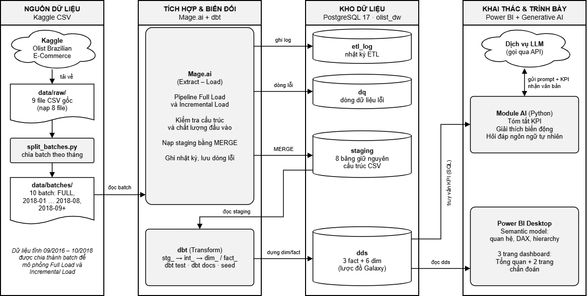

# [BI-Seminar] – Hệ thống BI tích hợp AI

> Mini project môn Business Intelligence – Nhóm [số nhóm]

## 1. Giới thiệu
- **Bối cảnh:** [Lĩnh vực, ví dụ: bán lẻ, du lịch, khí hậu...]
- **Dataset:** [Tên dataset] – [Link Kaggle] (chi tiết: [docs/dataset.md](docs/dataset.md))
- **Mục tiêu phân tích:** [1–2 câu] (chi tiết: [docs/business_questions.md](docs/business_questions.md))

## 2. Thành viên nhóm

| MSSV | Họ tên | Phụ trách |
|------|--------|-----------|
|      |        | Mage – Data Ingestion |
|      |        | dbt – Transformation & Tests |
|      |        | Data Warehouse – Thiết kế & SQL |
|      |        | Power BI – Semantic Model & Dashboard |
|      |        | Generative AI |

## 3. Kiến trúc hệ thống



```
Kaggle CSV → Mage.ai (staging) → dbt (dds: Star Schema) → Power BI
                                                        ↘ AI (LLM) → Summary / Giải thích
```

## 4. Công nghệ sử dụng

| Thành phần | Công nghệ | Phiên bản |
|------------|-----------|-----------|
| Data Ingestion | Mage.ai | |
| Transformation | dbt | |
| Data Warehouse | PostgreSQL | 17 |
| BI | Power BI Desktop | |
| Generative AI | [Tên LLM / API] | |

## 5. Cấu trúc thư mục

```
bi-miniproject/
├── data/          # raw: file gốc Kaggle | batches: dữ liệu chia đợt (incremental)
├── scripts/       # Script phụ trợ (chia batch, ...)
├── sql/           # Tạo database, schema, bảng log; checks: query kiểm tra
├── mage/          # Project Mage.ai (pipelines Full Load / Incremental Load)
├── dbt/           # Project dbt: staging → intermediate → marts
├── powerbi/       # File .pbix, measures.dax, theme
├── ai/            # Trích xuất KPI + gọi LLM + prompts + kết quả
└── docs/          # Tài liệu, hình ảnh, báo cáo, video demo
```

## 6. Hướng dẫn chạy nhanh
Xem chi tiết tại [docs/setup_guide.md](docs/setup_guide.md).

1. [Bước 1]
2. [Bước 2]
3. [Bước 3]

## 7. Sản phẩm nộp

| # | Sản phẩm | Vị trí |
|---|----------|--------|
| 1 | Báo cáo PDF | `docs/report/` |
| 2 | Source code | `mage/`, `dbt/`, `sql/`, `ai/` |
| 3 | Power BI (.pbix) | `powerbi/` |
| 4 | Link Kaggle + hướng dẫn chạy | `docs/dataset.md`, `docs/setup_guide.md` |
| 5 | Video demo | `docs/demo/README.md` |
