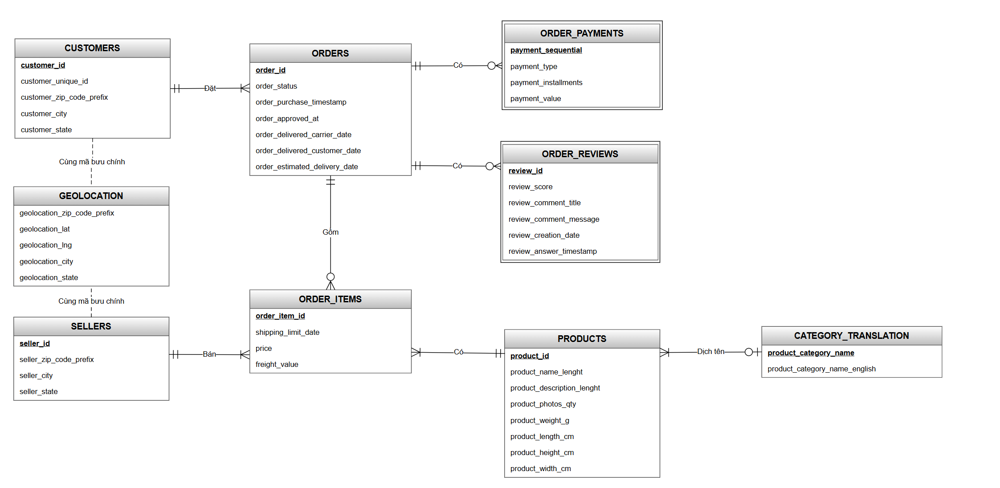

# Dữ liệu gốc – Brazilian E-Commerce Public Dataset by Olist

| Mục | Nội dung |
|---|---|
| Nguồn | https://www.kaggle.com/datasets/olistbr/brazilian-ecommerce (tác giả: Olist) |
| Giấy phép | [CC BY-NC-SA 4.0](https://creativecommons.org/licenses/by-nc-sa/4.0/): chỉ dùng phi thương mại, phải ghi nguồn, chia sẻ lại cùng giấy phép |
| Ngày tải | 10/10/2026; 9 file CSV, giữ nguyên bản gốc, **không chỉnh sửa** |
| Quy mô | 99.441 đơn hàng, mua từ 09/2016 đến 10/2018; khoảng 121 MB |
| Tiền tệ | Real Brazil (BRL), không quy đổi |

## 1. Giới thiệu

Olist là doanh nghiệp công nghệ của Brazil, cung cấp nền tảng giúp các cửa hàng nhỏ đưa sản phẩm lên các sàn thương mại điện tử lớn thông qua một hợp đồng duy nhất. Khách hàng mua trên sàn; người bán đăng ký với Olist tự xử lý đơn và bàn giao cho đơn vị vận chuyển; sau khi nhận hàng, khách được mời đánh giá đơn hàng. Bộ dữ liệu đã ẩn danh: không có tên khách hàng, tên người bán, tên sản phẩm.

## 2. Các file

| File | Bảng | Số dòng | Khóa | Nạp vào hệ thống |
|---|---|---|---|---|
| `olist_orders_dataset.csv` | `orders` | 99.441 | `order_id` | Có |
| `olist_order_items_dataset.csv` | `order_items` | 112.650 | (`order_id`, `order_item_id`) | Có |
| `olist_order_payments_dataset.csv` | `order_payments` | 103.886 | (`order_id`, `payment_sequential`) | Có |
| `olist_order_reviews_dataset.csv` | `order_reviews` | 99.224 | (`review_id`, `order_id`); `review_id` một mình không duy nhất | Có |
| `olist_customers_dataset.csv` | `customers` | 99.441 | `customer_id` (mỗi đơn một `customer_id`; khách thật là `customer_unique_id`) | Có |
| `olist_products_dataset.csv` | `products` | 32.951 | `product_id` | Có |
| `olist_sellers_dataset.csv` | `sellers` | 3.095 | `seller_id` | Có |
| `product_category_name_translation.csv` | `category_translation` | 71 | `product_category_name` | Có |
| `olist_geolocation_dataset.csv` | `geolocation` | 1.000.163 | Không có khóa | **Không**: không câu hỏi nào cần tọa độ; địa lý lấy bang, thành phố từ `customers` và `sellers` |

## 3. Đặc điểm cần lưu ý

Toàn vẹn tham chiếu giữa các bảng chính tốt (0 dòng mồ côi), nhưng dữ liệu có một số điểm phải xử lý ở `staging` và dbt:

| Đặc điểm | Cách xử lý |
|---|---|
| Đầu kỳ, cuối kỳ rất thưa hoặc bị cắt dở (09/2016 chỉ 4 đơn; từ 23/08/2018 số đơn mỗi ngày giảm mạnh) | Phân tích xu hướng trong khoảng 01/2017 – 08/2018 |
| Một đơn có nhiều sản phẩm, nhiều lần thanh toán, có thể nhiều đánh giá | Doanh thu tính từ `order_items`; gom về đúng grain trước khi nối bảng |
| Bình luận đánh giá có xuống dòng bên trong ô | Đọc bằng CSV parser chuẩn (`pandas.read_csv`, `COPY ... CSV`) |
| Mã bưu chính có số 0 đầu (`01037`) | Giữ dạng chuỗi |
| 610 sản phẩm thiếu danh mục; 2 danh mục thiếu bản dịch; tên cột sai chính tả `*_lenght` | Bổ sung bản dịch bằng dbt seed; đổi tên cột ở model `stg_products` |
| Một số đơn có mốc thời gian mâu thuẫn (đơn `delivered` thiếu ngày giao, ngày bàn giao trước ngày mua) | Cờ `is_date_valid`; KPI giao hàng chỉ tính đơn hợp lệ |

Mô tả từng cột: [docs/data_dictionary.md](../../docs/data_dictionary.md). Kết quả khảo sát đầy đủ (23 vấn đề xếp theo mức độ): [docs/data_profiling.md](../../docs/data_profiling.md).

## 4. Cách dùng trong đồ án

- Các file ở đây là đầu vào cho `scripts/` (khảo sát, kiểm chứng khóa) và cho `scripts/split_batches.py`, script chia dữ liệu thành 10 batch mô phỏng Full Load và Incremental Load ([data/batches/README.md](../batches/README.md)).
- Không sửa trực tiếp các file này; mọi bước làm sạch thực hiện ở `staging` và dbt.
- Các file được commit lên repo (đánh dấu `-text` trong `.gitattributes`) để mọi thành viên dùng đúng một bản, không phải tải lại từ Kaggle.
