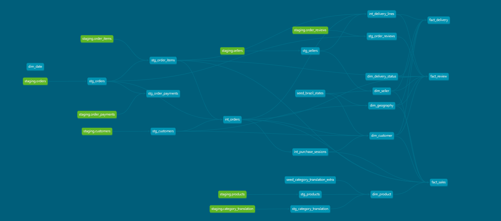

# dbt – Data Transformation

> Project dbt `olist_dw`: biến đổi schema `staging` (Mage nạp) thành kho `dds` (Galaxy schema) cho Power BI.
> Công thức từng cột: [docs/source_to_target_mapping.md](../docs/source_to_target_mapping.md) · thiết kế kho: [docs/dw_design.md](../docs/dw_design.md).
> **Quy tắc, mẫu code, số liệu nghiệm thu cho người viết model: [docs/dbt_rules.md](../docs/dbt_rules.md).**
> Khởi tạo 23/10/2026: cấu hình, kết nối, nguồn, seed. Model BS-28 → BS-31 làm xong 24/10/2026: 20 model, 155 test (mục 4 – 6).
> Đối soát số liệu kho `dds` sau khi chạy: [sql/checks/02_dds_checks.sql](../sql/checks/02_dds_checks.sql).

## 1. Chạy dbt

dbt nằm sẵn trong container Mage (dbt-core 1.8.7, dbt-postgres 1.8.2). `compose.yaml` đặt `DBT_PROJECT_DIR` = `DBT_PROFILES_DIR` = `/home/src/dbt`, nên ở thư mục gốc repo chỉ cần gõ `docker compose exec mage dbt <lệnh>`.

**Lần đầu trên mỗi máy** (sau `git pull`):

```powershell
Copy-Item dbt\profiles.yml.example dbt\profiles.yml   # kết nối DB: đọc POSTGRES_* từ .env, không chứa mật khẩu
docker compose up -d                                   # tạo lại container Mage để nhận 2 biến DBT_* trong compose.yaml
docker compose exec mage dbt deps                      # cài dbt_utils đúng bản ghi trong package-lock.yml
docker compose exec mage dbt debug                     # phải ra: All checks passed!
```

`staging` phải có dữ liệu trước khi build: chạy Mage `full_load` + 9 lần `incremental_load` ([setup_guide.md](../docs/setup_guide.md) mục 6.2).
Khi chưa có model nào, dbt in `[WARNING]: … There are 3 unused configuration paths` – bình thường, tự hết khi mỗi thư mục có model.

| Muốn… | `docker compose exec mage …` |
|---|---|
| Dựng tất cả đúng thứ tự: seed → model → test | `dbt build` |
| 1 model và test của nó | `dbt build --select stg_orders` |
| 1 model và mọi model phía sau nó | `dbt build --select stg_orders+` |
| Chỉ test dữ liệu nguồn | `dbt test --select source:staging` |
| Sau khi chạy lại Full Load (staging làm lại từ đầu) | `dbt build --full-refresh` – dựng lại cả model `incremental` |
| Tài liệu + sơ đồ lineage | `dbt docs generate --static` → mở `dbt/target/static_index.html` bằng trình duyệt |

## 2. Cấu trúc và schema đích

| Thư mục | Tiền tố | Materialization | Schema | Nội dung |
|---|---|---|---|---|
| `models/staging/` | `stg_` | view | `dbt_stg` | 1 model / 1 bảng nguồn: ép kiểu, `TRIM`, đổi tên cột sai chính tả, bỏ đơn đã xóa mềm (R10) |
| `models/intermediate/` | `int_` | view | `dbt_int` | Phép tính dùng chung cho nhiều dim / fact: `int_orders`, `int_purchase_sessions`, `int_delivery_lines` |
| `models/marts/` | `dim_`, `fact_` | table (`dim_customer`, `dim_geography`: incremental) | `dds` | 6 dimension + 3 fact – Power BI chỉ đọc schema này |
| `seeds/` | `seed_` | table | `dbt_stg` | Dữ liệu tham chiếu nhóm tự bổ sung |
| `macros/` | | | | `generate_schema_name`: dùng đúng tên schema ở cột trên (mặc định dbt ghép thành `dbt_stg_dds`) |
| `tests/` | | | | Test viết tay (singular test), VD test xóa mềm R10 |
| dbt test | | table | `dq` | `store_failures`: dòng vi phạm của mỗi test vào 1 bảng, ghi đè ở mỗi lần chạy |

`staging` (Mage) và `dds` (Power BI) giữ đúng vai trò; view trung gian của dbt nằm riêng ở `dbt_stg`, `dbt_int` (dbt tự tạo 2 schema này).
Cấu hình: [dbt_project.yml](dbt_project.yml) · kết nối: [profiles.yml.example](profiles.yml.example) · package: [packages.yml](packages.yml).

## 3. Đã có sẵn

| Thứ | File | Ghi chú |
|---|---|---|
| Nguồn | `models/staging/_sources.yml` | 8 bảng `staging`. Model `stg_` đọc bằng `{{ source('staging', 'orders') }}`, tầng sau dùng `{{ ref('stg_orders') }}`. Test: 6 khóa ngoại (D2) + mã bang của `customers` / `sellers` có trong seed. Khóa chính không test lại vì `staging` đã có ràng buộc `PRIMARY KEY` |
| Seed | `seeds/seed_brazil_states.csv` | 27 bang → tên bang có dấu (VD `São Paulo`) + 5 vùng (Norte, Nordeste, Centro-Oeste, Sudeste, Sul) |
| | `seeds/seed_category_translation_extra.csv` | 2 bản dịch còn thiếu: `pc_gamer`, `portateis_cozinha_e_preparadores_de_alimentos` |
| Mô tả + test seed | `seeds/_seeds.yml` | Mã bang không trùng, vùng thuộc 5 giá trị |
| Package | `packages.yml` | `dbt_utils` 1.3.x – `unique_combination_of_columns` cho khóa ghép (mapping mục 5) |

Đã chạy thử trên dữ liệu đủ 10 batch (23/10/2026): `dbt build` đạt hết (2 seed, 14 test); làm mồ côi 1 đơn thì test báo `FAIL 1` và dòng lỗi nằm trong `dq`.

## 4. Việc tiếp theo

| Task | Tạo gì | Công thức (source_to_target_mapping.md) |
|---|---|---|
| BS-28 – Models tầng staging | 8 model `stg_<tên bảng>` + `_stg_models.yml` | Mục 0.1, R10; `stg_products` đổi `*_lenght` → `*_length` |
| BS-29 – Models tầng intermediate | `int_orders`, `int_purchase_sessions`, `int_delivery_lines` + macro `normalize_city` | R1, R4, R6, R7, R9 |
| BS-30 – Models Dimension | 6 model `dim_` | Mục 2, R2 (khóa số nguyên ổn định, member `-1`) |
| BS-31 – Model Fact | 3 model `fact_` + singular test xóa mềm trong `tests/` | Mục 3, R5; số dòng / test dự kiến ở mục 5 |

Quy ước: mỗi task 1 file yml cạnh model (`_stg_models.yml`, `_int_models.yml`, `_dim_models.yml`, `_fact_models.yml`) chứa mô tả model, cột, test; mô tả viết tiếng Việt – dbt docs (Metadata) lấy từ đây. Chi tiết từng task: [docs/dbt_rules.md](../docs/dbt_rules.md).

**Trạng thái (24/10/2026): cả 4 task đã xong** (Nhựt Thanh). `dbt build` cả project: `PASS=177 ERROR=0` (2 seed, 20 model, 155 test), chạy lại nhiều lần vẫn đạt. Số dòng và số liệu đối soát khớp [dbt_rules.md](../docs/dbt_rules.md) B6. Đã chạy các kịch bản B7:

| Kịch bản | Kết quả |
|---|---|
| 1. Build sau khi nạp đủ 10 batch | `ERROR=0`; số liệu khớp B6 (`sql/checks/02_dds_checks.sql`) |
| 2. Build lại khi dữ liệu không đổi | Khóa 4 dimension giữ nguyên 100%; `dim_geography` báo `INSERT 0 0` |
| Có khách / thành phố mới (mô phỏng: xóa 200 khách, 20 thành phố khỏi dimension rồi build lại) | Khách cũ giữ khóa; khách mới nhận khóa nối tiếp 96.097 → 96.296; vẫn đúng 1 dòng `-1` |
| 4. Xóa mềm 1 đơn rồi build | Đơn biến mất khỏi 3 fact (mỗi fact giảm 1 dòng); khách vẫn còn trong `dim_customer`, giữ khóa, chuyển sang "Chưa có đơn hợp lệ". Khôi phục đơn → số liệu trở lại như cũ |

Lỗi môi trường đã gặp: build song song 3 fact báo `could not resize shared memory segment … No space left on device` (lúc có lúc không). Nguyên nhân: Docker mặc định cho container Postgres 64 MB bộ nhớ dùng chung (`/dev/shm`). Đã thêm `shm_size: 256mb` cho service `postgres` trong `compose.yaml` – máy nào đã bật container trước đó thì chạy `docker compose up -d` để tạo lại container (dữ liệu trong volume không mất).

## 5. Danh sách model

20 model + 1 macro. Mô tả từng cột nằm trong file yml cạnh model (xem bằng `dbt docs`).

| Model | Tầng (schema) | Đọc từ | Một dòng là | Số dòng |
|-------|---------------|--------|-------------|---------|
| `stg_orders` | staging (`dbt_stg`, view) | `source: staging.orders` | 1 đơn chưa bị xóa (R10 lọc ở đây) | 99.441 |
| `stg_order_items` | staging | `source: order_items`, `stg_orders` | 1 đơn vị sản phẩm trong 1 đơn | 112.650 |
| `stg_order_payments` | staging | `source: order_payments`, `stg_orders` | 1 lần thanh toán (chưa bảng dds nào dùng) | 103.886 |
| `stg_order_reviews` | staging | `source: order_reviews`, `stg_orders` | 1 đánh giá cho 1 đơn | 99.224 |
| `stg_customers` | staging | `source: customers` | 1 `customer_id` = địa chỉ nhận của 1 đơn | 99.441 |
| `stg_sellers` | staging | `source: sellers` | 1 người bán | 3.095 |
| `stg_products` | staging | `source: products` | 1 sản phẩm (đổi tên `*_lenght` → `*_length`) | 32.951 |
| `stg_category_translation` | staging | `source: category_translation` | 1 bản dịch danh mục | 71 |
| `int_orders` | intermediate (`dbt_int`, view) | `stg_orders`, `stg_customers`, `stg_order_items` | 1 đơn + khách thật, nơi nhận đã chuẩn hóa (R1), cờ đơn hợp lệ (R4) | 99.441 |
| `int_purchase_sessions` | intermediate | `int_orders` | 1 đơn hợp lệ + lần mua thứ mấy (R6) | 98.199 |
| `int_delivery_lines` | intermediate | `stg_order_items`, `int_orders`, `stg_sellers` | 1 cặp (đơn, người bán) + 4 số ngày (R7) + 3 nhãn trạng thái (R9) | 100.010 |
| `dim_date` | marts (`dds`, table) | tự sinh | 1 ngày, 2016 – 2018 | 1.096 |
| `dim_delivery_status` | marts (table) | tự sinh | 1 tổ hợp trạng thái giao hàng (8 × 4 × 3 × 7) | 672 |
| `dim_product` | marts (table) | `stg_products`, `stg_category_translation`, seed | 1 sản phẩm | 32.952 |
| `dim_seller` | marts (table) | `stg_sellers`, seed | 1 người bán | 3.096 |
| `dim_geography` | marts (incremental) | `stg_customers`, seed | 1 thành phố của 1 bang (nơi nhận) | 4.310 |
| `dim_customer` | marts (incremental) | `stg_customers`, `int_orders`, `int_purchase_sessions`, seed | 1 khách hàng thực | 96.097 |
| `fact_sales` | marts (table) | `stg_order_items`, `int_orders`, `int_purchase_sessions`, 4 dim | 1 sản phẩm của 1 người bán trong 1 đơn hợp lệ | 101.953 |
| `fact_delivery` | marts (table) | `int_delivery_lines`, 4 dim | 1 cặp (đơn, người bán) | 100.010 |
| `fact_review` | marts (table) | `stg_order_reviews`, `stg_order_items`, `int_orders`, `int_delivery_lines`, 4 dim | 1 đánh giá × 1 người bán của đơn | 100.568 |

Số dòng dim có tính 1 dòng `-1` "Không xác định" (trừ `dim_date`, `dim_delivery_status`). Macro `normalize_city` (R1) dùng ở `int_orders`, `dim_geography`, `dim_customer`, `dim_seller`.

## 6. Data tests

155 test: nguồn 8, seed 6, staging 6, intermediate 17, dimension 60, fact 58. Mỗi test trả về các dòng **vi phạm**; 0 dòng = đạt. Dòng vi phạm được lưu vào schema `dq` (mỗi test 1 bảng, ghi đè mỗi lần chạy).

| Model.Cột | Test | Mục đích |
|-----------|------|----------|
| Nguồn `staging` | `relationships` (6 khóa ngoại D2, mã bang khớp seed) | Phát hiện dòng mồ côi do Mage nạp thiếu |
| Mọi `*_key` của dimension, khóa tự nhiên (`customer_unique_id`, `product_id`, `seller_id`, `full_date`), `order_id` của `int_orders`, `int_purchase_sessions` | `unique`, `not_null` | Mỗi thực thể đúng 1 dòng, không có khóa rỗng |
| `int_delivery_lines` (đơn, người bán); `dim_geography` (bang, thành phố); `dim_delivery_status` (4 nhãn); khóa chính 3 fact (6 / 6 / 8 cột) | `dbt_utils.unique_combination_of_columns` | Đúng grain: không nhân dòng khi nối bảng |
| Mọi khóa ngoại của 3 fact; mã bang của `dim_seller`, `dim_geography`, `dim_customer` | `relationships` | Fact chỉ trỏ tới khóa có thật trong dimension; mã bang có trong seed |
| `order_status`, `payment_type`, `review_score` (1–5), `handover_status`, `route_type`, `delay_bucket`, `delivery_result`, `customer_type`, `weight_class`, `region`, thứ / tháng / quý / năm của `dim_date` | `accepted_values` | Nhãn đúng chính tả (có dấu, gạch "–") để fact tra được `dim_delivery_status` và Power BI lọc đúng |
| `quantity` ≥ 1, `unit_price` > 0, `revenue` > 0, `freight_value` ≥ 0, `purchase_seq` ≥ 1, `purchase_count` ≥ 0, `delivery_days` ≥ 0, `transit_days` ≥ 0 | `dbt_utils.accepted_range` | Số liệu không âm / không bằng 0 bất thường |
| `fact_sales`: `revenue = quantity × unit_price`; `dim_date`: `date_key` khớp ngày, `year_month`, `is_weekend`; `dim_customer`: loại khách khớp số lần mua; `dim_product`: nhóm khối lượng khớp khối lượng; `fact_delivery`: `late_days` và `delivery_days` cùng có / cùng NULL | `dbt_utils.expression_is_true` | Các cột phải khớp nhau theo quy tắc nghiệp vụ |
| `tests/test_normalize_city.sql` | Viết tay | 10 ví dụ của R1 (bỏ dấu, cắt `/`, bỏ ngoặc, mã bang, email…) phải cho đúng kết quả |
| `tests/assert_dim_unknown_members.sql` | Viết tay | Mỗi dimension có đúng 1 dòng `-1` (quan trọng với 2 dimension incremental) |
| `tests/assert_no_deleted_orders_in_facts.sql` | Viết tay | Đơn đã xóa mềm (R10) không còn trong fact nào |
| `tests/assert_one_latest_review_per_order.sql` | Viết tay | Mỗi đơn có đúng 1 đánh giá `is_latest_review` → K8, K9 không đếm lặp |
| `tests/assert_facts_match_sources.sql` | Viết tay | Tổng `quantity`, tổng `revenue`, số dòng `fact_delivery`, số lượt đánh giá khớp nguồn → không nhân dòng, không mất dòng. So với nguồn chứ không so với số cố định nên vẫn đúng khi xóa đơn |

Tổng tiền, số dòng **không** viết thành test cứng (demo xóa đơn sẽ làm chúng đổi) – đối soát bằng `sql/checks/02_dds_checks.sql`.

## 7. Lineage graph


