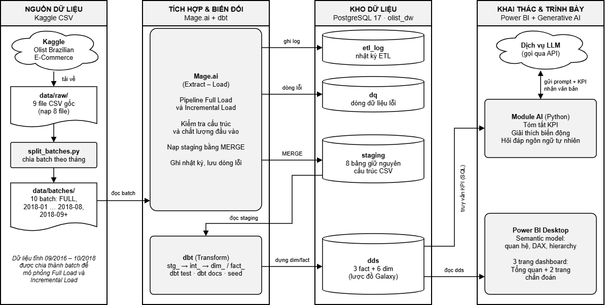
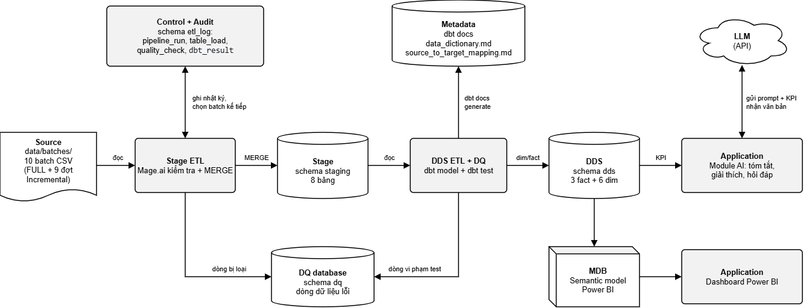

# Kiến trúc hệ thống

> Sơ đồ: [images/architecture.drawio](images/architecture.drawio) (2 trang: `[Seminar] - Kiến trúc tổng thể`, `[Seminar] - Luồng dữ liệu`);
> ảnh xuất: [images/architecture.png](images/architecture.png) (trang 1), [images/data_flow.png](images/data_flow.png) (trang 2).
> Dùng cho báo cáo Chương 4 (Hình 4.1, Hình 4.2). Trạng thái ghi trong file cập nhật ngày 21/10/2026.

## 1. Kiến trúc được chọn: Single DDS

- Theo bài giảng, kiến trúc **Single DDS** (Dimensional Data Store) có 2 vùng lưu trữ:
  - **Stage**: giữ tạm dữ liệu vừa trích xuất, gần như nguyên dạng nguồn;
  - **DDS**: dữ liệu đã làm sạch, tích hợp, tổ chức theo mô hình đa chiều (fact / dimension) để phân tích.
- **Lý do chọn:** chỉ có 1 nguồn dữ liệu (Olist), quy mô ~100 nghìn đơn, xử lý theo lô; Q1–Q6 trả lời được trực tiếp từ mô hình đa chiều
  → không cần thêm NDS (Normalized Data Store – kho chuẩn hóa trung gian) hay ODS (Operational Data Store – dữ liệu vận hành gần thời gian thực).
- Tên schema `dds` trong database lấy theo cách gọi này (đổi từ `dwh` ngày 12/10/2026).

## 2. Kiến trúc tổng thể (Hình 4.1)

### 2.1. Các tầng

| Tầng | Thành phần | Vai trò |
|---|---|---|
| Nguồn dữ liệu | 8 file CSV Olist (`data/raw/`), script `scripts/split_batches.py` | Dữ liệu tĩnh → chia thành **10 batch** theo tháng mua (FULL, 2018-01 … 2018-08, 2018-09+) để mô phỏng dữ liệu mới đến định kỳ |
| Tích hợp & biến đổi | Mage.ai, dbt | **Mage** (Extract – Load): đọc batch, kiểm tra chất lượng, MERGE vào `staging`, ghi nhật ký. **dbt** (Transform): biến đổi `staging` thành dim / fact trong `dds`, chạy dbt test |
| Kho dữ liệu | PostgreSQL 17, database `olist_dw` | 4 schema: `staging`, `dds`, `etl_log` (nhật ký ETL), `dq` (dòng dữ liệu lỗi) + 2 schema làm việc dbt tự tạo: `dbt_stg`, `dbt_int` (view trung gian `stg_`, `int_`, seed) |
| Khai thác & trình bày | Power BI Desktop, module AI, dịch vụ LLM | Power BI: semantic model + dashboard. Module AI: lấy KPI đã tính từ `dds`, gửi kèm prompt tới LLM để tạo tóm tắt / giải thích |

### 2.2. Triển khai

| Thành phần | Chạy ở đâu | Truy cập |
|---|---|---|
| PostgreSQL 17 | Container `olist-postgres` (image `postgres:17`); dữ liệu trong volume `bi-miniproject_pgdata`; script `sql/init/` tự chạy khi volume còn trống | `localhost:5432` |
| Mage.ai 0.9.79 + dbt 1.8 | Container `olist-mage` (build từ `docker/Dockerfile`); cả repo gắn vào `/home/src`; dbt chạy bằng `docker compose exec mage dbt ...` | http://localhost:6789 |
| Power BI Desktop, DBeaver | Cài trực tiếp trên Windows | Kết nối DB qua `localhost:5432` |
| Module AI | Chưa chốt (xem [../ai/README.md](../ai/README.md)) | |
| LLM | Dịch vụ bên ngoài, gọi qua API – chưa chọn | |

Hai container khai báo chung trong `compose.yaml` (Docker Compose, project `bi-miniproject`) → cả nhóm dựng cùng một môi trường bằng `docker compose up -d --build`.
Hướng dẫn chạy từng bước: [setup_guide.md](setup_guide.md).

## 3. Luồng dữ liệu (Hình 4.2)

### 3.1. Đối chiếu Single DDS → đồ án

| Thành phần Single DDS | Trong đồ án | Chi tiết | Trạng thái (21/10/2026) |
|---|---|---|---|
| Source System | 10 batch CSV trong `data/batches/` | [../data/batches/README.md](../data/batches/README.md) | ✅ Script chia batch xong, tự kiểm tra 9/9 PASS |
| Stage ETL | Pipeline Mage: kiểm tra → MERGE vào `staging` (Full Load / Incremental Load), xóa mềm | [pipeline_rules.md](pipeline_rules.md), [decisions.md](decisions.md) D1–D8, [../mage/README.md](../mage/README.md) | ✅ Pipeline `full_load` + `incremental_load` xong (BS-21 → BS-24); chạy đủ 9 kịch bản kiểm thử, nạp hết 10 batch khớp 100% `data/raw/` |
| Stage | Schema `staging`: 8 bảng giữ nguyên cấu trúc CSV + `_batch_id`, `_loaded_at` | [data_dictionary.md](data_dictionary.md) | ✅ Đã tạo bảng (`sql/init/01_staging_tables.sql`) |
| DDS ETL + DQ | dbt: model `stg_` → `int_` → `dim_` / `fact_`, seed, dbt test | [source_to_target_mapping.md](source_to_target_mapping.md), [dbt_rules.md](dbt_rules.md), [../dbt/README.md](../dbt/README.md) | ⏳ Ánh xạ xong (BS-15); đã khởi tạo project dbt (23/10/2026: nguồn, seed, test nguồn), chờ viết model (BS-28 → BS-31) |
| DDS | Schema `dds`: 3 fact + 6 dim, lược đồ Galaxy | [dw_design.md](dw_design.md) | ✅ Thiết kế xong, chưa có bảng |
| Control + Audit | Schema `etl_log`: `pipeline_run`, `table_load`, `quality_check` | `sql/init/02_etl_log.sql`, [../mage/README.md](../mage/README.md) mục Ghi log | ✅ Mage ghi đủ 3 bảng ở mọi lần chạy; Incremental đọc `pipeline_run` để lấy LSET |
| DQ database | Schema `dq`: dòng bị Mage loại (`rejected_rows`) + dòng vi phạm dbt test (`store_failures`) | [decisions.md](decisions.md) (bảng cuối, 19/10/2026), `sql/init/03_dq.sql` | ✅ Mage ghi dòng bị loại vào `rejected_rows`; phần dbt `store_failures` ⏳ |
| Metadata | dbt docs, data dictionary, ánh xạ nguồn → đích | | Tài liệu ✅, dbt docs ⏳ |
| MDB | Semantic model trong Power BI (quan hệ, DAX, hierarchy) | [../powerbi/README.md](../powerbi/README.md) | ⏳ |
| Application | Dashboard Power BI (3 trang); module AI (tóm tắt, giải thích, hỏi đáp) | [../powerbi/README.md](../powerbi/README.md), [../ai/README.md](../ai/README.md) | ⏳ Mới phác thảo dashboard, chưa chọn LLM |

### 3.2. Luồng chính

1. **Source → Stage ETL:** Mage đọc lần lượt từng batch. **Trước khi nạp**, kiểm tra cấu trúc (đủ, đúng cột) và chất lượng cơ bản (khóa không rỗng, không trùng).
   Lỗi nặng (VD thiếu cột) → dừng, lần chạy ghi `FAILED`; dòng hỏng lẻ → loại riêng, phần còn lại nạp tiếp.
2. **Stage ETL → Stage:** dữ liệu đạt được **MERGE theo khóa chính** vào `staging` – dòng mới thì thêm, dòng đã có thì cập nhật
   (phương án B – D8: đơn cũ được gửi lại ở batch sau với trạng thái mới). Đơn nguồn báo xóa (`deleted_orders.csv`) được **xóa mềm**
   (`_is_deleted = TRUE`), dbt bỏ qua khi dựng `dds`. Quy tắc chi tiết cho pipeline: [pipeline_rules.md](pipeline_rules.md).
3. **Stage → DDS ETL + DQ → DDS:** dbt đọc `staging`, biến đổi qua 3 lớp `stg_` (làm sạch từng bảng) → `int_` (tích hợp, tính toán dùng chung)
   → `dim_` / `fact_` (bảng trong `dds`); seed bổ sung vùng của bang và bản dịch 2 danh mục còn thiếu; dbt test kiểm tra kết quả.
4. **DDS → Application:** 2 nhánh như mô hình –
   (a) Power BI kết nối `dds`, dựng semantic model (đóng vai MDB) rồi dashboard;
   (b) module AI truy vấn trực tiếp KPI đã tính từ `dds`, gửi tới LLM → AI chỉ nói dựa trên số đã tính, đối chiếu được với dashboard.

### 3.3. Ba vùng hỗ trợ

| Vùng | Lưu gì | Dùng để |
|---|---|---|
| **Control + Audit** (`etl_log`) | Thông tin **về** mỗi lần chạy: trạng thái, khoảng dữ liệu (`lset`, `cet`), số dòng đọc / thêm / cập nhật / loại, kết quả từng phép kiểm tra | **Audit**: biết pipeline chạy ổn không. **Control**: Incremental đọc lần chạy thành công gần nhất để chọn batch kế tiếp → chạy lại được |
| **DQ database** (`dq`) | **Chính các dòng dữ liệu lỗi**, giữ nguyên nội dung + lý do, từ 2 điểm kiểm tra (Mage, dbt test) | Người phụ trách xem dòng nào hỏng để sửa nguồn rồi nạp lại. `etl_log` chỉ **đếm**, không giữ nội dung |
| **Metadata** | dbt docs (tự sinh: mô tả model, cột, test, sơ đồ lineage) + `data_dictionary.md`, `source_to_target_mapping.md` (nhóm viết) | Hiểu ý nghĩa dữ liệu, biết bảng nào được làm từ bảng nào |

## 4. Câu hỏi hay gặp khi trình bày

| Câu hỏi | Trả lời ngắn |
|---|---|
| Sao không đưa CSV thẳng vào Power BI? | (1) 9 bảng rời, dữ liệu bẩn – nối sai là doanh thu bị nhân lên (1 đơn nhiều sản phẩm × nhiều lần thanh toán); (2) làm sạch + test **một lần** ở dbt, mọi báo cáo dùng chung; (3) dữ liệu đến theo đợt → cần nạp thêm (incremental) và ghi lịch sử mỗi lần nạp |
| Mage khác dbt chỗ nào? | Mage chuyển dữ liệu **từ ngoài vào** database (E, L); dbt biến đổi dữ liệu **bên trong** database (T) – dbt không tự đọc file CSV |
| Mage kiểm tra chất lượng khác dbt test chỗ nào? | Mage kiểm tra **trước khi nạp** `staging` (đủ file, đúng cột, khóa không rỗng / không trùng, đúng kiểu dữ liệu) và loại dòng hỏng; dbt test kiểm tra **sau khi biến đổi**, chỉ phát hiện chứ không xóa dòng sai |
| `etl_log` khác `dq` chỗ nào? | `etl_log` ghi **về** lần chạy (con số, trạng thái); `dq` giữ **chính dòng dữ liệu lỗi** |
| dbt `store_failures` có thay được `rejected_rows` không? | Không – dòng Mage loại không bao giờ vào database nên dbt không thấy; `store_failures` còn ghi đè mỗi lần chạy, không giữ lịch sử |
| Xóa một đơn ở nguồn rồi chạy Incremental thì sao? | Incremental chỉ thấy dòng **có mặt** trong batch, không thể coi "vắng mặt" là "bị xóa" (mỗi batch chỉ là một phần dữ liệu). Nên nguồn phải **báo xóa** bằng file `deleted_orders.csv`; Mage **xóa mềm** (`_is_deleted = TRUE`, giữ dấu vết, đếm vào `etl_log`); dbt bỏ đơn đó khi dựng `dds` → biến mất khỏi dashboard. Olist thật không xóa đơn – đơn hủy là đổi trạng thái `canceled`, tức nguồn đã dùng soft delete (slide 53) |
| Sao chọn Single DDS? | 1 nguồn, dữ liệu nhỏ, xử lý theo lô, câu hỏi chỉ cần mô hình đa chiều → không cần NDS / ODS |
