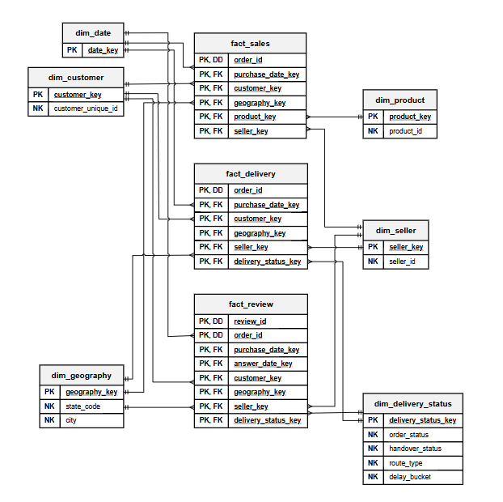
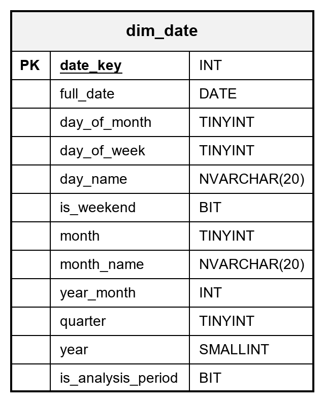
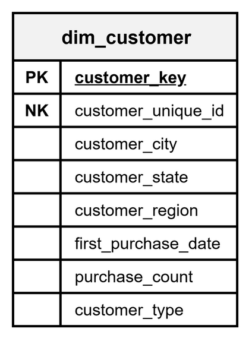
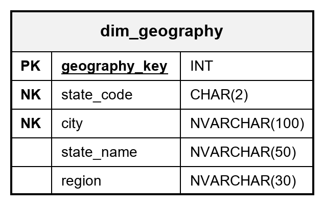
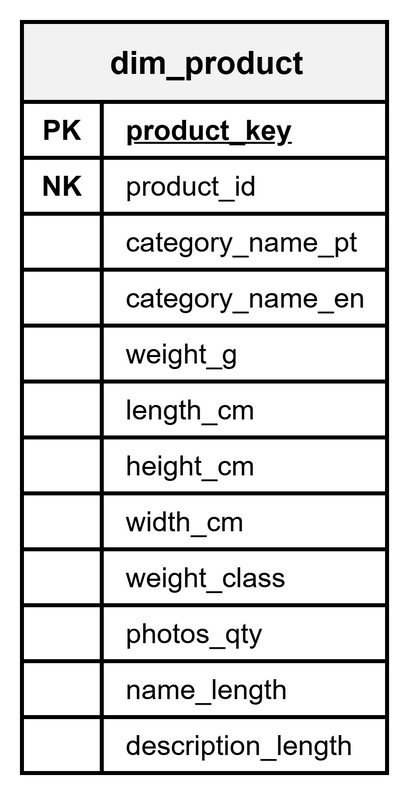
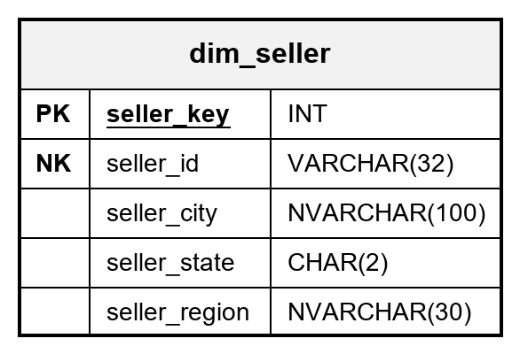
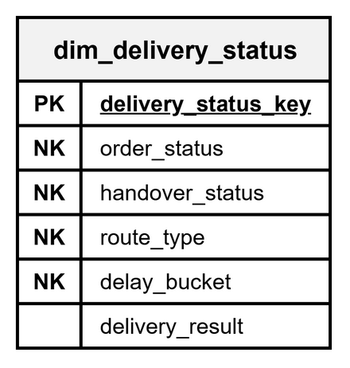
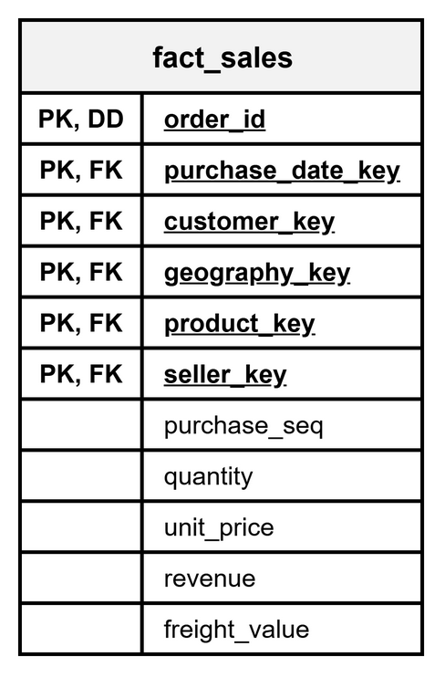
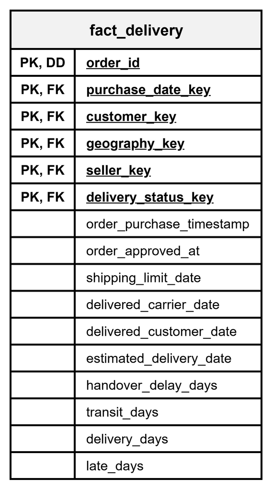
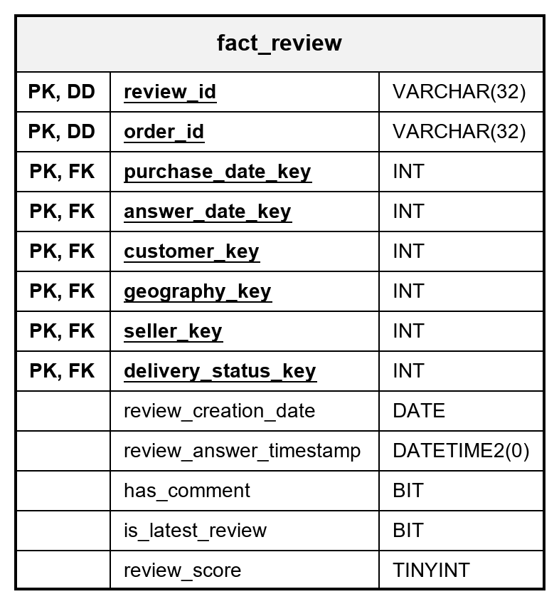

# Thiết kế Data Warehouse

> Sơ đồ: [images/dds_schema.drawio](images/dds_schema.drawio) (3 trang: Dimension, Fact, Lược đồ tổng thể); ảnh xuất ở [images/dds/](images/dds/).
> Số dòng ghi trong file tính trực tiếp trên 9 CSV gốc theo đúng quy tắc dưới đây; số chính thức lấy từ `dds` sau khi dbt chạy xong batch cuối.

**Quy ước chung**

- Thiết kế theo trình tự bài giảng (Bài 3): câu hỏi nghiệp vụ → quy trình / sự kiện → **grain** → dimension → measure → khóa → SCD → phân cấp → lược đồ.
- **Khóa chính của fact = khóa của mọi dimension liên quan** (FK) **+ degenerate dimension** (`order_id`, `review_id`) khi tổ hợp FK chưa đủ duy nhất.
  Không dùng surrogate key riêng cho fact. Vì cột thuộc khóa chính không được NULL, FK thiếu được gán member **`-1` "Không xác định"**.
- Dimension dùng **surrogate key** `INT` sinh trong dbt, giữ **khóa tự nhiên** (NK) của nguồn. Dimension phi chuẩn hóa (star): phân cấp nằm trong cùng một bảng.
- Phân cấp viết theo chiều **chi tiết → tổng quát** (drill-down đi ngược lại).
- Kiểu dữ liệu SQL Server: mã hash `VARCHAR(32)`, văn bản có dấu `NVARCHAR`, tiền `DECIMAL`, mốc thời gian `DATETIME2(0)`, ngày `DATE`, cờ `BIT`.

## 1. Quy trình nghiệp vụ (Business Process)

Mỗi quy trình có câu hỏi nghiệp vụ hỏi tới thì lập **một bảng fact**; quy trình không có câu hỏi thì không lập fact.

| Quy trình | Sự kiện nghiệp vụ (event) | Câu hỏi / KPI phục vụ | Bảng nguồn (staging) | Fact |
|---|---|---|---|---|
| **Bán hàng** | Khách đặt mua sản phẩm của một người bán trong một đơn hàng | Q1, Q2, Q6 · K1–K5, K10, K11, K13, M1–M3, M5 | `order_items`, `orders`, `customers`, `products`, `sellers` | `fact_sales` |
| **Giao hàng** | Người bán bàn giao hàng cho đơn vị vận chuyển và hàng được giao tới khách | Q3, Q4, Q5, Q6 · K6, K7, K12, M4, M5 | `orders`, `order_items`, `customers`, `sellers` | `fact_delivery` |
| **Đánh giá** | Khách trả lời khảo sát mức độ hài lòng sau khi mua | Q4, Q6 · K8, K9, M5 | `order_reviews`, `orders`, `order_items`, `customers` | `fact_review` |

- **Thanh toán** (`order_payments`) không lập fact: không câu hỏi nào dùng tới; doanh thu lấy từ `order_items.price` vì tổng thanh toán lệch tiền hàng + phí ship ở 249 đơn (lãi trả góp, voucher). Dữ liệu vẫn nằm ở `staging` để mở rộng sau.
- Ba fact dùng chung các dimension (`dim_date`, `dim_customer`, `dim_geography`, `dim_seller`, `dim_delivery_status`) → lược đồ **chòm sao (Galaxy / Fact Constellation)**.

## 2. Grain của bảng Fact

| Fact | Loại fact | Một dòng = | Khóa chính | Số dòng |
|---|---|---|---|---|
| `fact_sales` | Transaction | **một sản phẩm do một người bán bán trong một đơn hàng hợp lệ** (gộp các đơn vị cùng sản phẩm) | `order_id`, `purchase_date_key`, `customer_key`, `geography_key`, `product_key`, `seller_key` | 101.953 |
| `fact_delivery` | Accumulating snapshot | **một lượt bàn giao – giao hàng của một người bán cho một đơn hàng** | `order_id`, `purchase_date_key`, `customer_key`, `geography_key`, `seller_key`, `delivery_status_key` | 100.010 |
| `fact_review` | Transaction | **một lượt đánh giá của khách cho một đơn hàng, gắn với một người bán của đơn đó** | `review_id`, `order_id`, `purchase_date_key`, `answer_date_key`, `customer_key`, `geography_key`, `seller_key`, `delivery_status_key` | 100.568 |

**`fact_sales`**
- `order_items` ghi mỗi **đơn vị** sản phẩm một dòng (không có cột số lượng). Trong cùng (`order_id`, `product_id`, `seller_id`), giá, phí ship và hạn bàn giao **giống hệt nhau ở 100% nhóm** → gộp thành 1 dòng không mất thông tin, và có được measure `quantity` (7.088 dòng có `quantity` > 1; tổng 112.101 đơn vị).
- Không gộp lên cấp đơn vì Q2 cần danh mục, Q6 cần doanh thu theo người bán. Một sản phẩm trong một đơn chỉ do đúng 1 người bán bán (0 ngoại lệ).
- Chỉ chứa **đơn hợp lệ** (trạng thái khác `canceled`, `unavailable`, có sản phẩm) theo định nghĩa K1: loại 472 dòng của 467 đơn.
- Tổ hợp FK chưa đủ duy nhất: **87** tổ hợp (khách, ngày, sản phẩm, người bán) xuất hiện ở hơn 1 đơn (khách đặt lại cùng món trong ngày) → thêm degenerate dimension `order_id` vào khóa (bài giảng C17, trường hợp 2).

**`fact_delivery`**
- Accumulating snapshot: một dòng theo dõi một lượt giao hàng qua các mốc *đặt → duyệt → bàn giao vận chuyển → giao khách*. Theo phương án B (D8), dòng xuất hiện ở batch đầu tiên của đơn và được **cập nhật** khi batch sau mang mốc mới.
- Grain (đơn, người bán) vì: hạn bàn giao `shipping_limit_date` là của từng người bán (duy nhất trong mỗi cặp đơn – người bán, 0 ngoại lệ); 1.278 đơn có nhiều người bán; Q5 cần biết người bán bàn giao trễ hay không và tuyến nội bang / liên bang (bang người bán so với bang khách).
- Ngày giao vận chuyển và ngày khách nhận chỉ có ở **cấp đơn** → 4 measure cấp đơn lặp lại ở 1.278 đơn nhiều người bán (1,3%). KPI cấp đơn (K6, K7, M4) đếm / lấy trung bình theo **`order_id` riêng biệt**.
- Gồm mọi đơn có sản phẩm (98.666 đơn), kể cả đơn hủy (để theo dõi trạng thái); 775 đơn không có sản phẩm không có người bán bàn giao nên không vào fact.
- `delivery_status_key` thuộc khóa và đổi theo trạng thái → fact được dbt **dựng lại toàn bộ** mỗi lần chạy (materialized `table`), không cập nhật khóa tại chỗ.

**`fact_review`**
- Gắn người bán vào grain vì Q6 cần điểm đánh giá trung bình **của từng người bán**: đánh giá của đơn nhiều người bán được tính cho mọi người bán của đơn đó. 99.224 đánh giá → 100.568 dòng.
- `review_id` không duy nhất (789 mã dùng chung cho nhiều đơn) nên khóa giữ cả `review_id` và `order_id`.
- 759 dòng thuộc đơn không có sản phẩm → `seller_key = -1` (Không xác định).
- 547 đơn có hơn 1 đánh giá (202 đơn khác điểm) → cờ `is_latest_review` = 1 cho đánh giá trả lời muộn nhất của mỗi đơn (98.673 đơn), dùng cho KPI "1 điểm / đơn" (K8, K9).
- Hai vai trò ngày: `purchase_date_key` (so sánh theo tháng mua cùng `fact_delivery` ở Q4) và `answer_date_key` (ngày sự kiện đánh giá xảy ra).

## 3. Sơ đồ lược đồ (Galaxy Schema)

## 4. Các schema trong database

| Schema | Mục đích | Được tạo bởi |
|--------|----------|--------------|
| `staging` | Dữ liệu thô nạp từ nguồn | Mage.ai |
| `etl_log` | Nhật ký chạy pipeline | `sql/` + Mage.ai |
| `dds` | Dimensional Data Store: bảng Dimension & Fact | dbt |

## 5. Bảng Dimension

**Ma trận fact – dimension** (vai trò của dimension trong từng fact):

| Dimension | `fact_sales` | `fact_delivery` | `fact_review` |
|---|---|---|---|
| `dim_date` | Ngày đặt hàng | Ngày đặt hàng | Ngày đặt hàng; Ngày trả lời đánh giá |
| `dim_customer` | ✓ | ✓ | ✓ |
| `dim_geography` | Nơi nhận hàng | Nơi nhận hàng | Nơi nhận hàng |
| `dim_product` | ✓ | | |
| `dim_seller` | ✓ | ✓ | ✓ |
| `dim_delivery_status` | | ✓ | ✓ |

| Dimension | Một dòng = | Khóa tự nhiên | SCD | Phân cấp (chi tiết → tổng quát) | Số dòng |
|---|---|---|---|---|---|
| `dim_date` | một ngày dương lịch | `full_date` | Type 0 | Ngày → Tháng → Quý → Năm | 1.096 |
| `dim_customer` | một khách hàng thực | `customer_unique_id` | Type 1 | Khách hàng → Thành phố → Bang → Vùng | 96.096 (+1) |
| `dim_geography` | một thành phố (đã chuẩn hóa) của một bang | (`state_code`, `city`) | Type 0 | Thành phố → Bang → Vùng | ≈ 4.309 (+1) |
| `dim_product` | một sản phẩm | `product_id` | Type 1 | Sản phẩm → Danh mục | 32.951 (+1) |
| `dim_seller` | một người bán | `seller_id` | Type 1 | Người bán → Thành phố → Bang → Vùng | 3.095 (+1) |
| `dim_delivery_status` | một tổ hợp trạng thái giao hàng | (`order_status`, `handover_status`, `route_type`, `delay_bucket`) | Type 0 | Nhóm số ngày trễ → Kết quả giao | 672 |

(+1) = member `-1` "Không xác định".

### `dim_date`

- Sinh bằng dbt (không có nguồn), liên tục **01/01/2016 → 31/12/2018**: phủ ngày mua (04/09/2016 → 17/10/2018), ngày trả lời đánh giá (đến 29/10/2018) và ngày giao dự kiến (đến 12/11/2018).
- `date_key` = `YYYYMMDD`. `year_month` = `YYYYMM` làm khóa duy nhất cho cấp Tháng (tránh gộp tháng 1 của các năm khác nhau). `day_of_week` theo ISO (1 = Thứ Hai … 7 = Chủ nhật), không phụ thuộc `DATEFIRST`.
- `is_analysis_period` = 1 với 01/2017 – 08/2018 (phạm vi phân tích xu hướng, 99,6% số đơn).
- Là **role-playing dimension**: ngày đặt hàng (cả 3 fact) và ngày trả lời đánh giá (`fact_review`).

### `dim_customer`

- Khóa tự nhiên `customer_unique_id` (khách thực), **không** dùng `customer_id` (mã theo đơn – mỗi mã đúng 1 đơn, dựng theo mã này thì tỉ lệ mua lại luôn 0%) – D7.
- SCD **Type 1**: thành phố / bang / vùng lấy theo đơn **gần nhất** của khách. Chỉ 250 khách (0,26%) đổi mã bưu chính, 39 khách đổi bang; vị trí *tại thời điểm mua* vẫn giữ trong fact qua `dim_geography`.
- `purchase_count` = số **lần mua** hợp lệ (các đơn cách nhau ≤ 10 phút gộp thành 1 lần, D7); `customer_type` = "Mua một lần" / "Mua lại"; `first_purchase_date`.
- Khi incremental, dbt MERGE theo `customer_unique_id`: khách cũ giữ nguyên `customer_key`, cập nhật thuộc tính; khách mới nhận khóa mới.

### `dim_geography`

- Vai trò **nơi nhận hàng của đơn** (lấy từ dòng `customers` của chính đơn đó).
- Grain thành phố – bang, không theo mã bưu chính vì 33 mã bưu chính gắn với hơn 1 bang. Tên thành phố chuẩn hóa: bỏ dấu, chữ thường, `-` → khoảng trắng, gộp khoảng trắng (4.310 → 4.309 tổ hợp).
- `state_name`, `region` lấy từ dbt seed bang → vùng (5 vùng: Norte, Nordeste, Centro-Oeste, Sudeste, Sul).

### `dim_product`

- 610 sản phẩm thiếu danh mục → `category_name_pt = 'unknown'`; 2 danh mục thiếu bản dịch (`pc_gamer`, `portateis_cozinha_e_preparadores_de_alimentos`) bổ sung bằng dbt seed.
- Đổi tên cột sai chính tả `product_name_lenght`, `product_description_lenght`; khối lượng / kích thước = 0 → NULL.
- `weight_class`: < 0,5 kg · 0,5–2 kg · 2–5 kg · 5–10 kg · ≥ 10 kg · Không rõ.
- SCD Type 1: nguồn không có lịch sử thay đổi sản phẩm.

### `dim_seller`

- Vị trí người bán cố định (1 dòng / người bán ở nguồn) nên đặt thẳng trong dimension (star), không tách bảng địa lý riêng.
- Member `-1` dùng cho 759 dòng đánh giá của đơn không có sản phẩm.
- KPI *số người bán hoạt động* (K10) đếm trên fact, **không** đếm số dòng của bảng này (41,5% người bán chỉ bán lần đầu sau Full Load – D3).

### `dim_delivery_status`

Dimension gom các **thuộc tính suy ra** của một lượt giao hàng (business_questions mục 4.1). Sinh tĩnh bằng tích Descartes các giá trị hợp lệ: 8 × 4 × 3 × 7 = 672 dòng.

| Thuộc tính | Giá trị | Quy tắc |
|---|---|---|
| `order_status` | created, approved, invoiced, processing, shipped, delivered, canceled, unavailable | Trạng thái đơn (tại batch đang nạp – D8) |
| `handover_status` | Đúng hạn · Trễ hạn · Chưa bàn giao · Không xác định | So `delivered_carrier_date` với `shipping_limit_date` (theo giờ); thiếu ngày bàn giao → Chưa bàn giao; ngày bàn giao trước ngày mua hoặc không có người bán → Không xác định |
| `route_type` | Nội bang · Liên bang · Không xác định | Bang khách (nơi nhận) = bang người bán? |
| `delay_bucket` | Đúng hạn · Trễ 1–3 ngày · Trễ 4–7 ngày · Trễ 8–14 ngày · Trễ > 14 ngày · Chưa giao · Không xác định | `late_days` của đơn `delivered`; đơn khác `delivered` → Chưa giao; `delivered` nhưng thiếu ngày nhận (8 đơn) → Không xác định |
| `delivery_result` | Đúng hạn · Trễ hạn · Chưa giao · Không xác định | Cấp cha của `delay_bucket` |

## 6. Bảng Fact

### `fact_sales`

| Cột | Loại | Mô tả |
|---|---|---|
| `order_id` | PK, degenerate dimension | Mã đơn hàng |
| `purchase_date_key` | PK, FK → `dim_date` | Ngày đặt hàng |
| `customer_key` | PK, FK → `dim_customer` | Khách hàng thực |
| `geography_key` | PK, FK → `dim_geography` | Nơi nhận hàng của đơn |
| `product_key` | PK, FK → `dim_product` | Sản phẩm |
| `seller_key` | PK, FK → `dim_seller` | Người bán |
| `purchase_seq` | Thuộc tính | Lần mua thứ mấy của khách (gộp đơn cách nhau ≤ 10 phút) – dùng cho K5 theo kỳ |
| `quantity` | Measure | Số đơn vị sản phẩm |
| `unit_price` | Measure | Đơn giá (BRL) |
| `revenue` | Measure | `quantity × unit_price` = doanh thu dòng (BRL, không gồm phí ship) |
| `freight_value` | Measure | Tổng phí vận chuyển phân bổ cho dòng (BRL) |

### `fact_delivery`

| Cột | Loại | Mô tả |
|---|---|---|
| `order_id` | PK, degenerate dimension | Mã đơn hàng |
| `purchase_date_key` | PK, FK → `dim_date` | Ngày đặt hàng |
| `customer_key` | PK, FK → `dim_customer` | Khách hàng thực |
| `geography_key` | PK, FK → `dim_geography` | Nơi nhận hàng |
| `seller_key` | PK, FK → `dim_seller` | Người bán bàn giao |
| `delivery_status_key` | PK, FK → `dim_delivery_status` | Trạng thái lượt giao hàng |
| 6 cột mốc thời gian | Thuộc tính | `order_purchase_timestamp`, `order_approved_at`, `shipping_limit_date` (của người bán), `delivered_carrier_date`, `delivered_customer_date`, `estimated_delivery_date`; mốc chưa xảy ra = NULL |
| `handover_delay_days` | Measure (cấp người bán) | `delivered_carrier_date − shipping_limit_date` (ngày, dương = bàn giao trễ) |
| `transit_days` | Measure (cấp đơn) | `delivered_customer_date − delivered_carrier_date` (ngày) |
| `delivery_days` | Measure (cấp đơn) | `delivered_customer_date − order_purchase_timestamp` (ngày) |
| `late_days` | Measure (cấp đơn) | `DATE(delivered_customer_date) − estimated_delivery_date` (ngày, âm = giao sớm) |

Mỗi measure chỉ tính khi đủ 2 mốc và đúng thứ tự thời gian (VD 23 đơn khách nhận trước ngày bàn giao → `transit_days` = NULL); ngược lại để NULL.

### `fact_review`

| Cột | Loại | Mô tả |
|---|---|---|
| `review_id`, `order_id` | PK, degenerate dimension | Mã khảo sát và mã đơn được đánh giá |
| `purchase_date_key` | PK, FK → `dim_date` | Ngày đặt hàng của đơn |
| `answer_date_key` | PK, FK → `dim_date` | Ngày khách trả lời |
| `customer_key` | PK, FK → `dim_customer` | Khách đánh giá |
| `geography_key` | PK, FK → `dim_geography` | Nơi nhận hàng |
| `seller_key` | PK, FK → `dim_seller` | Người bán của đơn (`-1` nếu đơn không có sản phẩm) |
| `delivery_status_key` | PK, FK → `dim_delivery_status` | Trạng thái giao hàng của lượt (đơn, người bán) được đánh giá |
| `review_creation_date`, `review_answer_timestamp` | Thuộc tính | Ngày gửi khảo sát, thời điểm trả lời |
| `has_comment` | Thuộc tính | Có tiêu đề hoặc nội dung bình luận (sau TRIM, bỏ giá trị giả-NULL) |
| `is_latest_review` | Thuộc tính | 1 = đánh giá trả lời muộn nhất của đơn |
| `review_score` | Measure | Điểm 1–5 sao |

## 7. Measures

| Measure | Fact | Cột nguồn | Phép tổng hợp | Tính chất cộng dồn |
|---|---|---|---|---|
| `quantity` | `fact_sales` | `COUNT(order_items)` | SUM | Additive |
| `revenue` | `fact_sales` | `SUM(order_items.price)` | SUM | Additive |
| `freight_value` | `fact_sales` | `SUM(order_items.freight_value)` | SUM | Additive |
| `unit_price` | `fact_sales` | `order_items.price` | AVG có trọng số = `SUM(revenue) / SUM(quantity)` | Non-additive |
| `handover_delay_days` | `fact_delivery` | `orders`, `order_items` | AVG; đếm số lượt > 0 | Additive |
| `transit_days`, `delivery_days`, `late_days` | `fact_delivery` | `orders` | AVG theo **đơn riêng biệt** | Semi-additive: cộng được theo thời gian, khu vực…, **không** cộng qua các người bán của cùng một đơn |
| `review_score` | `fact_review` | `order_reviews.review_score` | AVG trên `is_latest_review = 1`, 1 điểm / đơn | Non-additive |

**Ánh xạ KPI → DW** (DAX chi tiết ở `powerbi/measures.dax`):

| KPI | Tính trên |
|---|---|
| K1 Doanh thu | `SUM(fact_sales.revenue)` |
| K2 Số đơn | `DISTINCTCOUNT(fact_sales.order_id)` |
| K3 AOV | K1 / K2 |
| K4 Số khách | `DISTINCTCOUNT(fact_sales.customer_key)` |
| K5 Tỉ lệ mua lại | Số khách có ≥ 2 giá trị `purchase_seq` khác nhau trong kỳ / K4 |
| K6 Tỉ lệ giao trễ | Số `order_id` có `delivery_result = 'Trễ hạn'` / số `order_id` có `delivery_result ∈ {Đúng hạn, Trễ hạn}` |
| K7 Thời gian giao TB | `delivery_days` trung bình theo đơn riêng biệt |
| K8 Điểm đánh giá TB | `review_score` trung bình, `is_latest_review = 1`, 1 dòng / đơn |
| K9 Tỉ lệ đánh giá tiêu cực | Số đơn có `review_score ≤ 2` / số đơn có đánh giá (`is_latest_review = 1`) |
| K10 Người bán hoạt động | `DISTINCTCOUNT(fact_sales.seller_key)` |
| K11 Doanh thu TB / người bán | K1 / K10 |
| K12 Tỉ lệ bàn giao trễ | Số dòng `fact_delivery` có `handover_status = 'Trễ hạn'` / số dòng có `handover_status ∈ {Đúng hạn, Trễ hạn}` (đúng grain đơn – người bán) |
| K13 Tỷ trọng top 10% người bán | Doanh thu của 10% `seller_key` dẫn đầu / K1 |
| M1, M2 | K1 cùng kỳ năm trước theo `dim_date`, % tăng trưởng |
| M3 | K1 / K1 bỏ bộ lọc danh mục, bang |
| M4 Thời gian vận chuyển TB | `transit_days` trung bình theo đơn riêng biệt |
| M5 Cờ người bán cần xử lý | Người bán có ≥ 30 đơn và (K8 < 3,5 hoặc K12 > 10%) – kết hợp 3 fact qua `dim_seller` |

Kiểm chứng sơ bộ trên CSV gốc với các quy tắc trên: doanh thu 01/2017 – 08/2018 = 13.449.529,68 BRL trên 97.905 đơn; tỉ lệ giao trễ 6.534 / 96.470 đơn = 6,77%; tỉ lệ bàn giao trễ ≈ 9,0% (8.913 / 99.000 lượt có ngày bàn giao).

## 8. Ánh xạ nguồn → đích (Source-to-Target Mapping)

| Cột nguồn (staging) | Phép biến đổi | Cột đích (dds) |
|---|---|---|
| *(không có nguồn)* | Sinh dãy ngày 2016-01-01 → 2018-12-31; tách ngày/tháng/quý/năm, tên thứ, tên tháng | `dim_date.*` |
| `customers.customer_unique_id` | Giữ nguyên (NK); `ROW_NUMBER()` → SK | `dim_customer.customer_unique_id`, `customer_key` |
| `customers.customer_city/state` của đơn mới nhất | Chuẩn hóa tên thành phố; nối seed bang → vùng | `dim_customer.customer_city/state/region` |
| `orders.order_purchase_timestamp` (đơn hợp lệ) | `MIN` → ngày mua đầu; gộp đơn cách nhau ≤ 10 phút → đếm lần mua | `dim_customer.first_purchase_date`, `purchase_count`, `customer_type` |
| `customers.customer_state`, `customer_city` | Chuẩn hóa thành phố; `DISTINCT` (bang, thành phố); nối seed bang → tên bang, vùng | `dim_geography.*` |
| `products.*`, `category_translation.*` (+ seed bản dịch bổ sung) | NULL danh mục → `unknown`; đổi tên cột `*_lenght` → `*_length`; 0 → NULL; phân nhóm khối lượng | `dim_product.*` |
| `sellers.*` | Chuẩn hóa thành phố; nối seed vùng; thêm dòng `-1` | `dim_seller.*` |
| *(không có nguồn)* | Tích Descartes các giá trị hợp lệ của 4 thuộc tính; suy `delivery_result` từ `delay_bucket` | `dim_delivery_status.*` |
| `order_items` GROUP BY (`order_id`, `product_id`, `seller_id`) | `COUNT(*)` → `quantity`; `MAX(price)` → `unit_price`; `SUM(price)` → `revenue`; `SUM(freight_value)` → `freight_value` | `fact_sales` measures |
| `orders.order_status` | Lọc bỏ `canceled`, `unavailable` | (điều kiện của `fact_sales`) |
| `orders.order_purchase_timestamp` | `CONVERT(INT, FORMAT(…, 'yyyyMMdd'))` | `*.purchase_date_key` |
| `orders.customer_id` → `customers.customer_unique_id` | Lookup SK | `*.customer_key` |
| `customers.customer_state`, `customer_city` của đơn | Lookup (bang, thành phố đã chuẩn hóa) | `*.geography_key` |
| `order_items.product_id`, `seller_id` | Lookup SK; không khớp → `-1` | `*.product_key`, `*.seller_key` |
| Các đơn của cùng khách theo thời gian | Đơn cách đơn trước > 10 phút → lần mua mới; đánh số tăng dần | `fact_sales.purchase_seq` |
| `order_items` GROUP BY (`order_id`, `seller_id`) + `orders`, `customers`, `sellers` | `MAX(shipping_limit_date)`; giữ các mốc của đơn; tính 4 measure ngày | `fact_delivery.*` |
| `orders.order_status`, mốc bàn giao, bang khách – bang người bán, `late_days` | Quy tắc mục 5 (`dim_delivery_status`) → lookup | `fact_delivery.delivery_status_key`, `fact_review.delivery_status_key` |
| `order_reviews.*` LEFT JOIN (`order_id`, `seller_id`) DISTINCT của `order_items` | Không có người bán → `-1`; TRIM bình luận, đổi giá trị giả-NULL thành NULL | `fact_review.*` |
| `order_reviews.review_answer_timestamp` | → `answer_date_key`; `ROW_NUMBER()` theo `order_id` giảm dần thời điểm trả lời = 1 → `is_latest_review` | `fact_review.answer_date_key`, `is_latest_review` |
