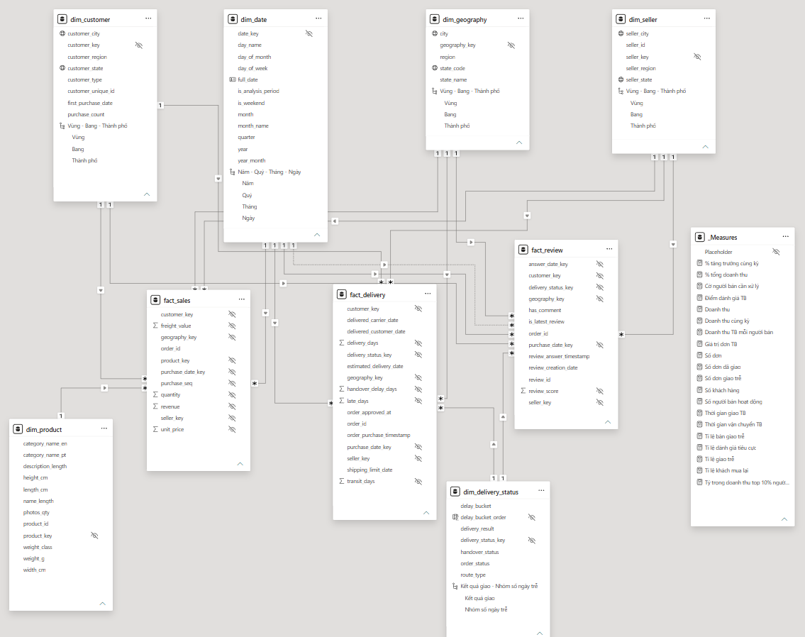

# Semantic Model Power BI

> Cùng cấu trúc với báo cáo `03.docx` **mục 7.1** (7.1.1 – 7.1.4). Bảng chi tiết (16 quan hệ, 20 measure, kết quả nghiệm thu đầy đủ): [powerbi/README.md](../powerbi/README.md). Quy tắc khi làm: [powerbi_rules.md](powerbi_rules.md). DAX: [powerbi/measures.dax](../powerbi/measures.dax).
> File model: `Dashboard seminar [Group-3].pbix` trên OneDrive nhóm (không lên Git). Người làm: Trần Kim Yến (BS-40), 29/10/2026.

## 7.1. Semantic Model

Semantic model là lớp ý nghĩa nghiệp vụ nằm giữa kho dữ liệu và báo cáo: các bảng nối với nhau thế nào, dữ liệu được xem theo những cấp nào, mỗi KPI tính ra sao. Mỗi KPI chỉ định nghĩa **một lần** trong model nên mọi biểu đồ dùng chung một con số. Trong kiến trúc Single DDS (Chương 4), model thuộc tầng khai thác và trình bày, đọc từ schema `dds`.

Ba nguyên tắc:

- **Import**: Power BI nạp 9 bảng `dds` vào bộ nhớ, nén theo cột. Mỗi fact ~100 nghìn dòng nên truy vấn nhanh, hàm thời gian chạy đủ, dashboard mở được khi không bật PostgreSQL. Đổi lại: phải Refresh sau mỗi lần pipeline nạp batch mới.
- **Không biến đổi dữ liệu trong Power Query**: làm sạch, tính cột đã ở dbt (mục 6.2) → mỗi quy tắc nghiệp vụ chỉ nằm một nơi, số dashboard luôn khớp `dds`.
- **Tắt Auto date/time**: model đã có `dim_date`, không cần Power BI tự tạo bảng ngày ẩn cho từng cột ngày.

| Thành phần | Số lượng | Nội dung |
|---|---|---|
| Bảng | 9 | 6 dimension, 3 fact của `dds`, giữ nguyên tên bảng và cột |
| Quan hệ | 16 | 15 hoạt động, 1 không hoạt động (ngày trả lời đánh giá) |
| Hierarchy | 5 | Thời gian, địa lý nơi nhận, địa lý người bán, địa lý khách hàng, kết quả giao |
| Cột tính toán (DAX) | 1 | `delay_bucket_order` – thứ tự hiển thị nhóm số ngày trễ |
| Measure (DAX) | 20 | 13 KPI (K1–K13), 5 bổ trợ (M1–M5), 2 trung gian |

### 7.1.1. Relationships

Lược đồ **Galaxy** (mục 5.5): 3 fact dùng chung dimension (conformed dimension). Mỗi quan hệ nối khóa ngoại của fact với khóa thay thế của dimension.

| Dimension | fact_sales | fact_delivery | fact_review |
|---|---|---|---|
| dim_date | purchase_date_key | purchase_date_key | purchase_date_key; answer_date_key (không hoạt động) |
| dim_customer | customer_key | customer_key | customer_key |
| dim_geography | geography_key | geography_key | geography_key |
| dim_product | product_key | – | – |
| dim_seller | seller_key | seller_key | seller_key |
| dim_delivery_status | – | delivery_status_key | delivery_status_key |



- **Nhiều–một (\*:1) và dòng "Không xác định"**: mọi dimension lấy từ nguồn có dòng khóa -1 (mục 6.2.3) → dòng fact nào cũng tìm được dimension, không có nhóm trống (Blank), tổng biểu đồ luôn bằng tổng bảng.
- **Lọc một chiều (Single)**: bộ lọc đi từ dimension xuống fact. Không dùng hai chiều (Both) vì 3 fact nối nhau qua dim chung → đường lọc vòng, số khó kiểm soát. Measure cần nhiều fact (M5) tự tính trong ngữ cảnh từng người bán.
- **Role-playing dimension**: `fact_review` có 2 cột ngày cùng trỏ `dim_date`. Power BI chỉ cho 1 quan hệ hoạt động giữa 2 bảng → ngày đặt hàng hoạt động (cả 3 trang phân tích theo ngày đặt), ngày trả lời bật khi cần:

  ```dax
  CALCULATE ( [Điểm đánh giá TB], USERELATIONSHIP ( fact_review[answer_date_key], dim_date[date_key] ) )
  ```
- **Date table**: `dim_date` được *Mark as date table* (cột `full_date`) để `SAMEPERIODLASTYEAR` (M1) tính đúng khi lọc theo năm / quý / tháng.
- **`dim_product` chỉ nối `fact_sales`**: grain của giao hàng và đánh giá không có sản phẩm → chọn danh mục chỉ đổi K1–K5. Đúng thiết kế, không thêm quan hệ để "sửa".

### 7.1.2. Hierarchies

Hierarchy sắp thuộc tính của dimension từ tổng quát đến chi tiết (Dimension → Hierarchy → Level → Member, Chương 5); người dùng drill-down / roll-up trên biểu đồ.

| Dimension | Các cấp | Dùng cho |
|---|---|---|
| dim_date | Năm → Quý → Tháng → Ngày | Xu hướng theo thời gian (Q1, Q3, Q4) |
| dim_geography | Vùng → Bang → Thành phố | Theo nơi nhận hàng (Q2, Q3) |
| dim_seller | Vùng → Bang → Thành phố | Vị trí người bán, nội bang / liên bang (Q5, Q6) |
| dim_customer | Vùng → Bang → Thành phố | Nơi ở hiện tại của khách |
| dim_delivery_status | Kết quả giao → Nhóm số ngày trễ | Điểm đánh giá theo mức trễ (Q4) |

`dim_geography` = nơi nhận của **từng đơn lúc mua**; `dim_customer` là SCD 1, chỉ giữ địa chỉ **mới nhất**. Phân tích đơn theo bang dùng `dim_geography` để khách chuyển nhà không làm đổi số của đơn cũ.

**Thứ tự hiển thị (Sort by column)** – cột chữ mặc định sắp theo chữ cái ("Tháng 10" trước "Tháng 2"):

- `month_name` ← `month`, `day_name` ← `day_of_week` (có sẵn trong `dim_date`).
- `delay_bucket` ← cột tính `delay_bucket_order`:

  ```dax
  delay_bucket_order = MOD ( dim_delivery_status[delivery_status_key] - 1, 7 ) + 1
  ```

  Công thức ban đầu dùng `SWITCH` trên `delay_bucket` → Power BI báo **circular dependency** (cột cần sắp xếp lại là nguồn của cột sắp xếp). Khóa của `dim_delivery_status` do dbt đánh số theo thứ tự cố định, 7 nhóm trễ ở vị trí trong cùng → chia lấy dư cho 7 ra đúng 1 → 7. Đánh đổi: đổi thứ tự / số nhóm trễ trong dbt thì phải sửa công thức (`decisions.md`, 29/10/2026).

**Ẩn cột**: mọi `*_key` và cột số của fact (`revenue`, `review_score`, `delivery_days`…) → người vẽ dashboard chỉ thấy thuộc tính dim + measure. Năm, tháng, quý đặt *Don't summarize*.

### 7.1.3. DAX Measures

Measure được tính lại theo bộ lọc đang áp dụng (**filter context**): cùng `Doanh thu` ra doanh thu của tháng, bang hay danh mục tùy ô. 20 measure đặt trong bảng `_Measures`, chia thư mục theo trang:

| Thư mục | Measure |
|---|---|
| 1 Tổng quan | Doanh thu (K1), Số đơn (K2), Giá trị đơn TB (K3), Số khách hàng (K4), Tỉ lệ khách mua lại (K5), Doanh thu cùng kỳ (M1), % tăng trưởng cùng kỳ (M2), % tổng doanh thu (M3) |
| 2 Giao hàng | Tỉ lệ giao trễ (K6), Thời gian giao TB (K7), Điểm đánh giá TB (K8), Tỉ lệ đánh giá tiêu cực (K9) |
| 3 Người bán | Số người bán hoạt động (K10), Doanh thu TB mỗi người bán (K11), Tỉ lệ bàn giao trễ (K12), Tỷ trọng doanh thu top 10% người bán (K13), Thời gian vận chuyển TB (M4), Cờ người bán cần xử lý (M5) |
| 0 Phụ | Số đơn giao trễ, Số đơn đã giao (tử số, mẫu số K6) |

**a. Vì sao dùng measure thay vì kéo cột** – doanh thu là measure cộng được (additive); tỉ lệ, trung bình không cộng được (non-additive, Chương 3). Tỉ lệ giao trễ cả năm ≠ tổng / trung bình tỉ lệ 12 tháng → phải tính lại từ tử số và mẫu số trong từng ô:

```dax
Số đơn giao trễ = CALCULATE ( DISTINCTCOUNT ( fact_delivery[order_id] ), dim_delivery_status[delivery_result] = "Trễ hạn" )
Số đơn đã giao  = CALCULATE ( DISTINCTCOUNT ( fact_delivery[order_id] ), dim_delivery_status[delivery_result] IN { "Đúng hạn", "Trễ hạn" } )
Tỉ lệ giao trễ  = DIVIDE ( [Số đơn giao trễ], [Số đơn đã giao] )
```

**b. Tính đúng theo grain** (mục 5.2):

| Fact | Một dòng là | Nếu tính thẳng trên dòng | Cách tính trong measure |
|---|---|---|---|
| fact_sales | 1 sản phẩm của 1 người bán trong 1 đơn | Số dòng > số đơn | Đếm `order_id`, `customer_key`, `seller_key` riêng biệt (K2, K4, K10) |
| fact_delivery | 1 cặp (đơn, người bán) | 1.278 đơn nhiều người bán bị tính nhiều lần | K6, K7, M4 tính trên từng `order_id`; K12 theo dòng (bàn giao là việc của từng người bán) |
| fact_review | 1 đánh giá × 1 người bán của đơn | 547 đơn nhiều đánh giá bị tính nhiều lần | Chỉ đánh giá mới nhất (`is_latest_review`), 1 điểm / đơn (K8, K9) |

```dax
Điểm đánh giá TB =
    CALCULATE (
        AVERAGEX ( VALUES ( fact_review[order_id] ), CALCULATE ( MAX ( fact_review[review_score] ) ) ),
        fact_review[is_latest_review] = TRUE ()
    )
```

**c. So sánh cùng kỳ (time intelligence)** – M1 dùng `SAMEPERIODLASTYEAR`. Năm 2016 rất thưa (mục 2.3) → so 2017 với 2016 ra mức tăng hàng nghìn %, vô nghĩa. M1 chỉ trả kết quả khi khoảng đang xét nằm trong 01–08/2018, còn lại BLANK (M2 BLANK theo):

```dax
Doanh thu cùng kỳ =
    VAR TrongKy = MIN ( dim_date[full_date] ) >= DATE ( 2018, 1, 1 )
               && MAX ( dim_date[full_date] ) <= DATE ( 2018, 8, 31 )
    RETURN IF ( TrongKy, CALCULATE ( [Doanh thu], SAMEPERIODLASTYEAR ( dim_date[full_date] ) ) )
```

**d. Cờ người bán cần xử lý (M5)** – 1 khi ≥ 30 đơn **và** (điểm < 3,5 **hoặc** bàn giao trễ > 10%). DAX coi BLANK là 0 khi so sánh → người bán chưa có đánh giá bị xem là "điểm < 3,5". Kiểm BLANK trước:

```dax
Cờ người bán cần xử lý =
    VAR Diem = [Điểm đánh giá TB]
    VAR TreBG = [Tỉ lệ bàn giao trễ]
    RETURN IF ( [Số đơn] >= 30
        && ( ( NOT ISBLANK ( Diem ) && Diem < 3.5 ) || ( NOT ISBLANK ( TreBG ) && TreBG > 0.1 ) ), 1, 0 )
```

K13 "top 10% người bán" làm tròn **lên** số người bán (`ROUNDUP`) – `decisions.md`, 29/10/2026.

### 7.1.4. Kiểm chứng số liệu

Truy vấn DAX trực tiếp vào model, so với SQL trên `dds`, kỳ 01/2017 – 08/2018 – khớp hết:

| KPI | SQL trên dds | Power BI |
|---|---|---|
| K1 Doanh thu (BRL) | 13.449.529,68 | 13.449.529,68 |
| K2 Số đơn | 97.905 | 97.905 |
| K6 Tỉ lệ giao trễ | 6.531 / 96.203 = 6,79% | 6,79% |
| K8 Điểm đánh giá TB | 4,09 | 4,09 |
| K9 Tỉ lệ đánh giá tiêu cực | 14,63% | 14,63% |
| K12 Tỉ lệ bàn giao trễ | 8.773 / 98.540 = 8,90% | 8,90% |
| K13 Tỷ trọng top 10% người bán | 67,38% | 67,38% |
| Q6 Người bán ≥ 30 đơn / cần xử lý | 633 / 191 | 633 / 191 |

Hành vi của model:

- Bảng theo tháng: dòng tổng của tỉ lệ / trung bình = số cả kỳ, không phải tổng các tháng.
- Chọn 1 bang → doanh thu, tỉ lệ trễ, điểm đều đổi (lọc xuống cả 3 fact).
- Chọn 1 danh mục → chỉ KPI bán hàng đổi (đúng 7.1.1).
- % tăng trưởng cùng kỳ chỉ có giá trị ở 01–08/2018.
- Chạy lại pipeline (`rerun_last`) rồi Refresh → mọi số không đổi.

**Tự kiểm nhanh trên máy khác** (sau khi mở file và Refresh): mở **DAX query view** (biểu tượng thứ 4 bên trái), dán và chạy:

```dax
EVALUATE
CALCULATETABLE (
    ROW ( "K1", [Doanh thu], "K2", [Số đơn], "K6", [Tỉ lệ giao trễ], "K8", [Điểm đánh giá TB],
          "K13", [Tỷ trọng doanh thu top 10% người bán] ),
    dim_date[is_analysis_period] = TRUE ()
)
```

Phải ra 13.449.529,68 · 97.905 · 0,0679 · 4,089 · 0,6738 (khi `dds` đủ 10 batch, không đơn nào bị xóa mềm). Lệch → kiểm `dds` bằng `sql/checks/02_dds_checks.sql` trước khi nghi model.
