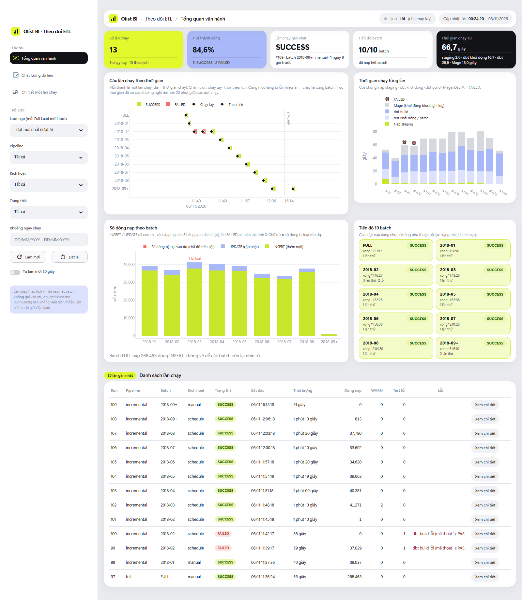
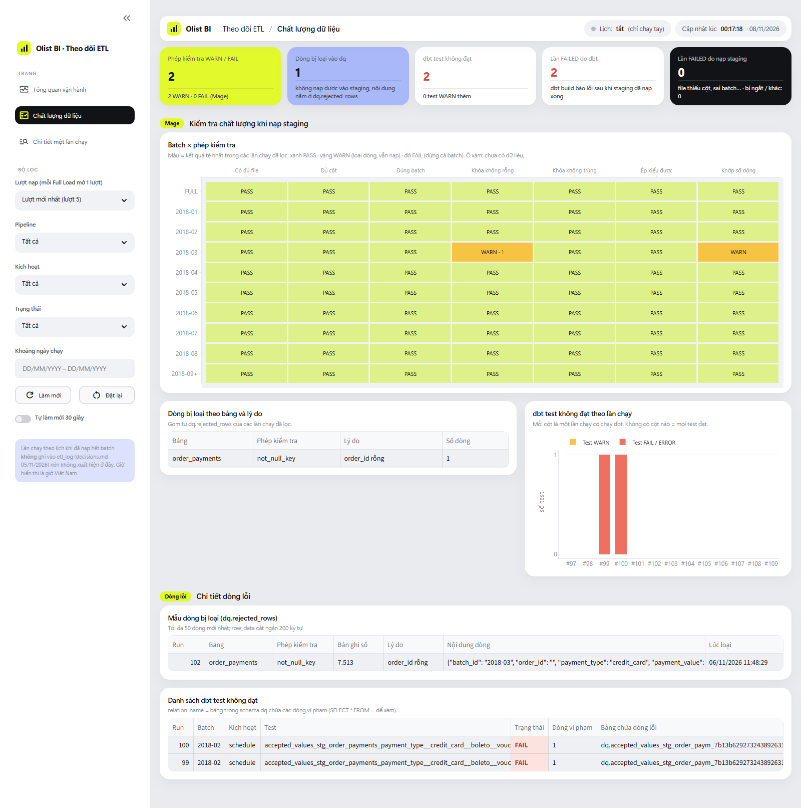
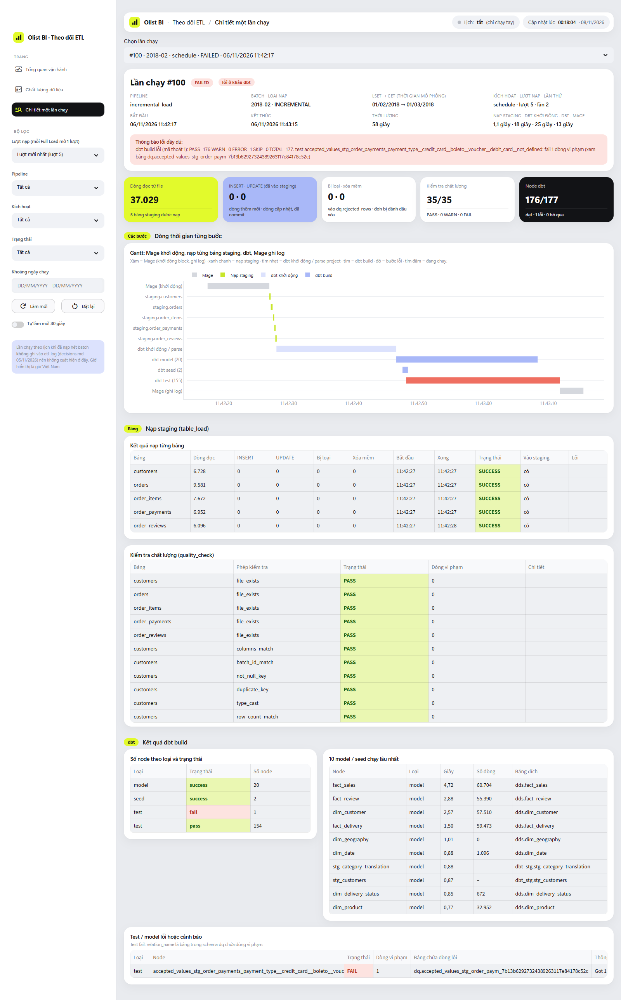

# monitor/ – Dashboard theo dõi mỗi lần chạy ETL (BS-54, Seminar 3)

> Làm 06/11/2026 (Yến). Lý do chọn công nghệ + quy ước số liệu: dòng 06/11/2026 ở bảng cuối [docs/decisions.md](../docs/decisions.md). Báo cáo: mục 6.3.5 của `03.docx`.

App Streamlit đọc nhật ký ETL (`etl_log.pipeline_run`, `table_load`, `quality_check`, `dbt_result`) và `dq.rejected_rows`
qua 3 view trong [`sql/init/06_etl_monitor.sql`](../sql/init/06_etl_monitor.sql), trả lời 3 câu hỏi vận hành:

1. Các lần chạy gần đây có thành công không, kho đã nạp tới batch nào, mỗi lần mất bao lâu?
2. Dữ liệu đầu vào lỗi ở batch nào, phép kiểm tra nào – do Mage chặn khi nạp hay do dbt test?
3. Một lần chạy lỗi ở khâu nào, từng bước mất bao lâu, dữ liệu có vào staging không?

Ví dụ đời thường: `etl_log` là **sổ nhật ký của bếp** (mỗi lần đi chợ – nấu ghi 1 dòng); dashboard này là **bảng theo dõi treo tường** – liếc qua là biết hôm nay nấu mấy mẻ, mẻ nào hỏng, hỏng ở khâu sơ chế hay khâu nấu.

App **chỉ đọc** (phiên kết nối đặt `default_transaction_read_only`), không ghi gì vào DB, không đụng pipeline Mage.

```
Mage (full_load / incremental_load, chạy tay hoặc theo lịch)
   │ ghi
   ▼
etl_log.pipeline_run ─┬─ table_load ─ quality_check        dq.rejected_rows
                      └─ dbt_result                              │
   │                                                             │
   ▼  sql/init/06_etl_monitor.sql (view, không lưu dữ liệu)      │
etl_log.v_run · v_batch_progress · v_quality_issue  ◄────────────┘
   │
   ▼
monitor/app.py (Streamlit, http://localhost:8502)  ◄── đọc thêm mage/.../triggers.yaml (lịch bật / tắt)
```

## 1. Các file

| File | Làm gì |
|---|---|
| `app.py` | Giao diện 3 trang, CSS theo theme Olist Lime Soft (giống dashboard Power BI) |
| `queries.py` | Mọi câu SQL và phép tính số liệu (app chỉ vẽ) |
| `db.py` | Kết nối Postgres, đọc `.env` ở gốc repo, phiên chỉ đọc |
| `kiem_tra_so_lieu.py` | Tính lại mọi số bằng SQL độc lập trên bảng gốc (không qua view) rồi so với số app hiển thị |
| `requirements.txt` | Thư viện (gần trùng `ai/requirements.txt` + `pyyaml`) |
| `chay_monitor.bat` | Bấm đúp để mở app |

View trong `06_etl_monitor.sql`:

| View | 1 dòng = | Dùng ở |
|---|---|---|
| `etl_log.v_run` (44 cột) | 1 lần chạy: thông tin lần chạy, lượt nạp, số lần thử, thời gian 4 khâu, số dòng đọc / đã commit / đã hoàn tác / bị loại / xóa mềm, số phép kiểm tra PASS / WARN / FAIL, số node dbt theo trạng thái, khâu gây lỗi, cờ nghi kẹt | Cả 3 trang; phần AI giải thích ETL sau này |
| `etl_log.v_batch_progress` | 1 batch × 1 lượt nạp (10 batch chuẩn × mọi lượt) | Lưới 10 batch, thẻ Tiến độ |
| `etl_log.v_quality_issue` | 1 phép kiểm tra WARN / FAIL của Mage hoặc 1 dbt test không đạt | Tra cứu bằng DBeaver |

## 2. Cài và chạy

1. Postgres đang chạy: `docker compose up -d` (ở gốc repo).
2. Tạo / cập nhật view – **1 lần** trên DB đã có từ trước 06/11/2026 (DB dựng mới thì Postgres tự chạy). Chạy từ **PowerShell**:

   ```powershell
   docker compose exec postgres psql -U olist_user -d olist_dw -f /sql/init/06_etl_monitor.sql
   ```

   Git Bash đổi `/sql/...` thành đường dẫn Windows → đặt `MSYS_NO_PATHCONV=1` trước lệnh. File tự `DROP VIEW` rồi tạo lại nên chạy lại bao nhiêu lần cũng được.
   Kiểm tra: `sql/checks/00_check_init.sql` phải ra **23 dòng PASS** (3 dòng cuối là 3 view).
3. Cài thư viện (1 lần): `py -m pip install -r monitor/requirements.txt`
4. Mở app: **bấm đúp `monitor\chay_monitor.bat`**, hoặc ở gốc repo:

   ```powershell
   py -m streamlit run monitor/app.py --server.port 8502 --server.address localhost --server.headless true --browser.gatherUsageStats false --client.toolbarMode minimal
   ```

   Rồi vào http://localhost:8502 (app Trợ lý AI dùng cổng 8501; file `.bat` tự mở trang này sau 5 giây). Các cờ: chỉ mở trong máy (không lộ ra mạng), `--server.headless true` bỏ qua câu hỏi email của Streamlit lần đầu chạy (câu hỏi này chặn app – lỡ gặp thì để trống, bấm Enter), không gửi thống kê sử dụng, ẩn nút Deploy.

Kết nối đọc `POSTGRES_DB`, `POSTGRES_USER`, `POSTGRES_PASSWORD`, `POSTGRES_PORT` trong `.env`. Host mặc định `127.0.0.1` (đổi bằng biến `MONITOR_DB_HOST`) – không dùng `localhost` vì khi DB tắt Windows thử IPv6 trước, mất ~16 giây mới báo lỗi.

## 3. Ba trang

Thanh bên (dùng chung): 3 nút trang · bộ lọc **Lượt nạp** (mặc định lượt mới nhất), Pipeline, Kích hoạt (`manual` / `schedule`), Trạng thái, Khoảng ngày chạy · nút Làm mới / Đặt lại · công tắc **Tự làm mới 30 giây**. Góc trên: trạng thái lịch (đọc `triggers.yaml`) và giờ cập nhật dữ liệu.
Màu: xanh chanh = SUCCESS / PASS, đỏ san hô = FAILED / FAIL, vàng = WARN, tím = RUNNING.

### Trang 1 – Tổng quan vận hành



| Thành phần | Đọc thế nào |
|---|---|
| 5 thẻ KPI | Số lần chạy (tay / theo lịch) · Tỉ lệ thành công (SUCCESS / số lần đã kết thúc) · Lần chạy gần nhất (trạng thái, batch, cách đây bao lâu) · Tiến độ batch (x/10 của lượt, LSET hiện tại) · Thời gian chạy TB tách 4 khâu |
| Cảnh báo | Chỉ hiện khi có vấn đề (bảng ở mục 5) |
| Các lần chạy theo thời gian | Mỗi thanh = 1 lần chạy (dài = thời gian chạy), hàng = batch, chấm tròn = chạy tay, thoi = theo lịch. Nhiều thanh cùng hàng = batch phải chạy lại. Khoảng nghỉ > 20 phút giữa các đợt bị cắt khỏi trục, chỗ cắt có vạch đứt "nghỉ 4 giờ" |
| Thời gian chạy từng lần | Cột chồng 4 khâu: nạp staging / dbt khởi động / dbt build / Mage; dấu ✕ = FAILED |
| Số dòng nạp theo batch | INSERT / UPDATE **đã commit**, chữ đỏ trên cột = số dòng bị loại vào `dq`. Batch FULL (268.463 dòng) không vẽ để các batch khác nhìn rõ |
| Tiến độ 10 batch | Mỗi ô 1 batch của lượt đang chọn: trạng thái, giờ xong, số lần thử, số lần lỗi |
| 20 lần chạy gần nhất | Nút **Xem chi tiết** ở cuối mỗi dòng → sang trang 3 của lần chạy đó (giữ nguyên bộ lọc). Ô **Lỗi** dài thì hiện "…", rê chuột vào thấy đủ. Màn hình hẹp hơn ~1280px (có thanh bên) thì bảng cuộn ngang |

### Trang 2 – Chất lượng dữ liệu



Thẻ (phép kiểm tra WARN / FAIL, dòng bị loại, dbt test không đạt, lần FAILED do dbt / do nạp staging) · ma trận batch × 7 phép kiểm tra của Mage (ô = kết quả tệ nhất trong các lần chạy đã lọc) · dòng bị loại theo bảng và lý do · dbt test không đạt theo lần chạy · mẫu 50 dòng mới nhất trong `dq.rejected_rows` · danh sách test fail kèm bảng `dq` chứa dòng vi phạm (`SELECT * FROM <bảng>` để xem).

### Trang 3 – Chi tiết một lần chạy



Chọn lần chạy ở ô trên cùng, hoặc mở thẳng `http://localhost:8502/?run_id=100`. Gồm: thông tin lần chạy + thông báo lỗi đầy đủ · thẻ số dòng / kiểm tra chất lượng / node dbt · **Gantt** (Mage khởi động → từng bảng staging → dbt khởi động → dbt model / seed / test → Mage ghi log; tổng chiều dài = thời lượng) · bảng `table_load`, `quality_check` · kết quả dbt (số node theo trạng thái, 10 node chạy lâu nhất, test lỗi).

Ảnh khác: [`03_chi_tiet_run_4.png`](../docs/images/etl_monitor/03_chi_tiet_run_4.png) (lỗi ở khâu nạp – cả batch hoàn tác), [`03_chi_tiet_run_102.png`](../docs/images/etl_monitor/03_chi_tiet_run_102.png) (SUCCESS có WARN), [`03_chi_tiet_run_97.png`](../docs/images/etl_monitor/03_chi_tiet_run_97.png) (Full Load), [`03_chi_tiet_run_16.png`](../docs/images/etl_monitor/03_chi_tiet_run_16.png) (dòng bị loại từ `deleted_orders`), [`05_dang_chay_run_109.png`](../docs/images/etl_monitor/05_dang_chay_run_109.png) (đang chạy ở khâu dbt – chụp trước khi Gantt có thanh Mage đầu / cuối), [`01b_tong_quan_1280.png`](../docs/images/etl_monitor/01b_tong_quan_1280.png) (màn hình 1280px).

## 4. Quy ước số liệu (dễ nhầm – đọc kỹ)

| Chỉ số | Cách tính | Vì sao |
|---|---|---|
| INSERT / UPDATE / xóa mềm | Chỉ cộng `table_load` **SUCCESS** (đã commit). Lần lỗi ở khâu nạp bị rollback cả batch → tính 0; số đã xử lý rồi hoàn tác nằm ở `rows_*_rollback`, trang 3 ghi "đã hoàn tác – KHÔNG vào staging" | `table_load` ghi số trước khi commit. Cộng thẳng thì thổi phồng: VD batch 2018-02 lượt 1 ra 55.304 INSERT trong khi chỉ 34.176 dòng thật sự vào staging |
| Dòng bị loại | Đếm thẳng `dq.rejected_rows` theo `run_id` | Gồm cả dòng bị loại của file `deleted_orders` (không có dòng `table_load` tương ứng) |
| Lượt nạp (`cycle_no`) | Mỗi Full Load có ≥ 1 bảng commit mở lượt mới; 1 lượt = 10 batch | Full Load làm lại staging từ đầu; Full Load lỗi ở khâu nạp đã rollback nên staging vẫn của lượt cũ |
| Số lần thử (`attempt_no`) | Thứ tự lần chạy trong các lần cùng batch, cùng lượt | Thấy batch nào phải chạy lại |
| Thời gian 4 khâu | Nạp staging = bảng đầu → bảng cuối · dbt khởi động = bảng cuối → node dbt đầu (~15–20 giây dbt đọc / parse project) · dbt build = node đầu → node cuối · Mage = phần còn lại (khởi động block, ghi log) | `dbt_result` chỉ có thời gian từng node |
| Khâu gây lỗi (`failed_stage`) | `bi_ngat` (lỗi "Bị ngắt giữa chừng") → `staging` (có `table_load` FAILED) → `dbt` (có node dbt lỗi) → `khac` | Biết ngay hỏng ở đâu mà không phải đọc thông báo lỗi |
| Trạng thái dbt | Ngoài `success` / `pass` / `warn` / `skipped` đều tính là **lỗi** | Bản dbt sau có thể thêm trạng thái mới – thà báo lỗi nhầm còn hơn bỏ sót |
| Đã nạp hết batch | Batch cuối `2018-09+` của lượt đã nạp | |
| Nghi kẹt (`is_stuck`) | RUNNING quá 15 phút | Lần chạy dài nhất đo được ~80 giây |

Giờ hiển thị là giờ Việt Nam (cột log đã lưu giờ VN). Lần chạy theo lịch khi đã nạp hết batch **không** ghi vào `etl_log` (decisions.md 05/11/2026) nên không hiện ở đây – xem ở tab Runs của Mage.

## 5. Cảnh báo (trang 1)

| Cảnh báo | Điều kiện | Mức |
|---|---|---|
| Lần chạy nghi kẹt | RUNNING quá 15 phút (thường do container tắt giữa chừng; lần chạy kế tiếp sẽ tự đổi thành FAILED) | Đỏ |
| Lần chạy gần nhất lỗi | Lần mới nhất FAILED, kèm thông báo lỗi rút gọn | Đỏ |
| Batch lỗi liên tiếp | 1 batch FAILED ≥ 2 lần liên tiếp (lịch tự thử lại mà nguồn chưa sửa) | Đỏ |
| Lịch bật nhưng không chạy | Trigger đang bật, còn batch chưa nạp, mà từ lần chạy theo lịch gần nhất (hoặc lúc bật lịch – `last_enabled_at` trong `triggers.yaml`) đã quá 3 chu kỳ cron. Không có cả 2 mốc thì bỏ qua | Vàng |

## 6. Demo / quay video cùng lịch

1. Mở app, bật **Tự làm mới 30 giây**.
2. Bật trigger `incremental_demo` (mage/README.md mục "Lập lịch") – góc trên app đổi thành "Lịch: bật".
3. Mỗi 5 phút có 1 lần chạy mới: thanh mới hiện ở dòng thời gian, ô batch chuyển SUCCESS, bảng 20 lần thêm 1 dòng. Bấm dòng đó → Gantt của lần vừa chạy.
4. (Tùy) Kịch bản lỗi T6 của [schedule_rules.md](../docs/schedule_rules.md): thấy cảnh báo đỏ, ô batch "2 lần thử · 1 lỗi", rồi tự phục hồi.
5. Xong tắt trigger. **Không** chạy tay pipeline khi trigger đang bật (schedule_rules B6 #8).

## 7. Kiểm chứng (06/11/2026, máy Yến)

| Kiểm | Kết quả |
|---|---|
| `py monitor/kiem_tra_so_lieu.py` (8 tổ hợp bộ lọc, 6 lần chạy khác loại: sạch, có WARN, FAILED do dbt, FAILED do staging, Full Load, có `dq` từ `deleted_orders`) | **1.989 / 1.989 số khớp** |
| QA độc lập lượt 1 (người kiểm tự viết SQL đối chiếu) | Bắt được lỗi số dòng lần chạy rollback bị tính là đã nạp, cách tính lượt nạp / khâu lỗi, ~20 lỗi giao diện → đã sửa |
| QA độc lập lượt 2 (9 tổ hợp bộ lọc, 11 lần chạy) | 945 / 945 số khớp; lỗi giao diện nhỏ còn lại đã sửa |
| Ca biên (DB tạm `olist_qa`, đã xóa) | `etl_log` trống, RUNNING kẹt, FAILED không có `table_load` / `dbt_result`, trạng thái dbt lạ, Full Load lỗi đã rollback, lần chạy bị ngắt: không lỗi, thẻ hiện "–" khi không có dữ liệu. Tắt Postgres: báo lỗi sau ~3–5 giây, bật lại thì tự kết nối |
| `00_check_init.sql` | 23 dòng PASS |
| Giao diện | 1280px và 900px, cả 3 trang, đổi trang luôn cuộn về đầu; ≤ 1000px các cặp biểu đồ / bảng xếp 1 cột, hàng thẻ KPI tự xuống dòng (900px: 3 + 2) |

Bài học: script tự kiểm ban đầu **không** bắt được lỗi rollback vì nó cộng số dòng giống hệt cách dashboard cộng. Câu đối chiếu phải viết theo định nghĩa nghiệp vụ, độc lập với code dashboard.

**Log dùng để kiểm và chụp ảnh** (`olist_dw` máy Yến, lượt nạp 5): run 97 FULL tay · 98 `2018-01` tay · 99, 100 `2018-02` theo lịch FAILED (dbt test `accepted_values` fail – 1 dòng `payment_type = pix` cố ý) · 101 tự phục hồi sau khi trả file đúng · 102 `2018-03` SUCCESS + 2 WARN, 1 dòng `dq` (1 dòng giả thiếu `order_id` cố ý) · 103–108 theo lịch (cron tạm `*/3`) · 109 `rerun_last` tay để chụp lúc đang chạy. File batch và `triggers.yaml` đã trả về gốc; md5 9 bảng `dds` + 8 bảng staging giống hệt trước đợt chạy → số Power BI không đổi.

## 8. Lỗi thường gặp

| Hiện tượng | Cách xử lý |
|---|---|
| "Không kết nối được Postgres" | `docker compose up -d`; kiểm tra `.env` có `POSTGRES_*` |
| Báo thiếu view `etl_log.v_run` | Chạy `06_etl_monitor.sql` (mục 2 bước 2) |
| `ModuleNotFoundError` | `py -m pip install -r monitor/requirements.txt` |
| `psql: ... No such file` khi chạy từ Git Bash | Chạy từ PowerShell hoặc `MSYS_NO_PATHCONV=1` |
| Chạy lại `06_etl_monitor.sql` báo "other objects depend on it" | Có view khác (VD của phần AI) dựa trên `v_run`: DROP view đó, chạy lại file, rồi tạo lại view đó. File cố ý không `CASCADE` để không âm thầm xóa view của người khác |
| Cổng 8502 đang bận | Đóng cửa sổ app cũ, hoặc đổi `--server.port` |

## 9. Hạn chế / hướng phát triển

- Lần chạy theo lịch khi đã hết batch không có trong `etl_log` → không hiện.
- `dbt_result` chỉ được ghi khi dbt build xong → lần đang ở khâu dbt chưa có thời gian từng node.
- Full Load đang chạy (vài giây đầu, chưa commit bảng nào) tạm được xếp vào lượt cũ.
- Chạy trên máy cục bộ, không đăng nhập.
- Hướng phát triển: thông báo email / Slack khi FAILED; AI giải thích từng lần chạy (đọc `v_run`); chỉ build các model dbt bị ảnh hưởng (dbt chiếm ~70% thời gian mỗi lần chạy, nạp staging ~3%).
