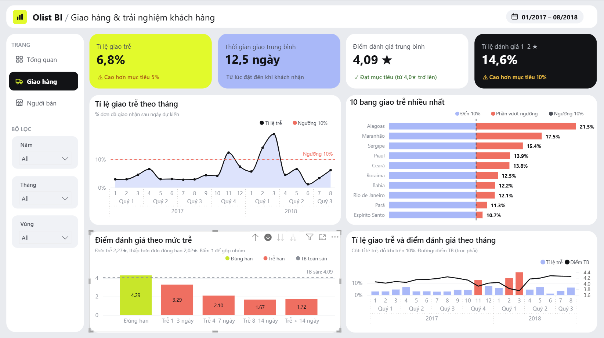

# Power BI – Semantic Model & Dashboard

## Semantic Model

### Relationships
| Từ (Fact) | Đến (Dimension) | Cardinality | Hướng lọc |
|-----------|-----------------|-------------|-----------|
|           |                 | *:1         | Single    |

### Hierarchies
| Dimension | Hierarchy |
|-----------|-----------|
| `dim_date` | Năm → Quý → Tháng → Ngày |
|           |           |

### Cột sắp xếp (Sort by column)
Cột chữ mặc định sắp theo bảng chữ cái → cần một cột số làm thứ tự: chọn cột chữ → *Column tools* → *Sort by column* → chọn cột số, rồi ẩn cột số khỏi report view.

| Bảng | Cột hiển thị | Sắp theo | Cột sắp xếp lấy từ |
|---|---|---|---|
| `dim_delivery_status` | `delay_bucket` | `delay_bucket_order` | Cột tính toán DAX bên dưới – **không có trong `dds`** (quyết định 17/10/2026, `docs/decisions.md`) |
| `dim_date` | `month_name` | `month` | Có sẵn trong `dds` |
| `dim_date` | `day_name` | `day_of_week` | Có sẵn trong `dds` |

```dax
delay_bucket_order =
SWITCH (
    dim_delivery_status[delay_bucket],
    "Đúng hạn",       1,
    "Trễ 1–3 ngày",   2,
    "Trễ 4–7 ngày",   3,
    "Trễ 8–14 ngày",  4,
    "Trễ > 14 ngày",  5,
    "Chưa giao",      6,
    "Không xác định", 7,
    99    // tên nhóm không khớp → dồn về cuối để dễ phát hiện
)
```

> Chuỗi trong `SWITCH` phải giống **từng ký tự** giá trị dbt sinh ra (dấu `–` là gạch ngang dài, không phải `-`). Đổi tên nhóm ở dbt thì sửa cả ở đây.
> Kiểm tra nhanh: tạo bảng gồm `delay_bucket` + `delay_bucket_order` – không dòng nào được ra 99.

### Measures (DAX)
> Toàn bộ DAX được sao lưu trong `measures.dax`.

| Measure | Mô tả | Dùng ở trang |
|---------|-------|--------------|
|         |       |              |

## Dashboard

> Câu hỏi, KPI và measure: [docs/business_questions.md](../docs/business_questions.md) mục 5–6.
> Số trên thẻ KPI trong phác thảo là số kiểm chứng sơ bộ trên CSV gốc (01/2017 – 08/2018), chỉ để minh họa.

**Nguyên tắc bố cục (áp dụng cho cả 3 trang)**
- Khung 16:9. Từ trên xuống: tiêu đề + slicer → hàng thẻ KPI → 2 câu hỏi, mỗi câu 1 hàng gồm 2 biểu đồ đặt cạnh nhau.
- Biểu đồ trái = **hiện tượng**, biểu đồ phải = **giải thích / khoanh vùng**; tiêu đề mỗi hàng ghi câu hỏi (Q1…).
- 1 màu chính cho mọi biểu đồ; **đỏ chỉ dùng cho cảnh báo** (vượt ngưỡng); xám cho đường tham chiếu/ngưỡng.
- Slicer dùng chung cho cả trang; click vào 1 biểu đồ sẽ lọc chéo các biểu đồ còn lại.

### Trang 1 – Tổng quan kinh doanh (Descriptive)

```
┌─────────────────────────────────────────────────────────────────────────────┐
│ TỔNG QUAN KINH DOANH                     [Năm ▼] [Tháng ▼] [Vùng ▼] [Bang ▼] │
├──────────────┬──────────────┬──────────────┬──────────────┬─────────────────┤
│ DOANH THU    │ SỐ ĐƠN       │ GIÁ TRỊ ĐƠN TB│ SỐ KHÁCH HÀNG│ KHÁCH MUA LẠI   │
│ 13,45 tr BRL │ 97.905       │ 137 BRL      │ 94.707       │ 2,3%            │
│ ▲ x% cùng kỳ │ ▲ x% cùng kỳ │              │              │                 │
├──────────────┴──────────────┴──────────────┴──────────────┴─────────────────┤
│ Q1. Doanh thu tăng bao nhiêu so với cùng kỳ, và tăng nhờ số đơn hay giá trị đơn?│
├──────────────────────────────────────┬──────────────────────────────────────┤
│ (1) Doanh thu theo tháng 2018 vs 2017│ (2) Số đơn (cột) và AOV (đường)       │
│  tr│        2017 ·····  2018 ────    │  đơn│              ▄█▄ ▄▄█▄▄▄▄▄  ─ 137 │
│ 1,0│  ───────────╮      ·            │     │        ▄▄▄██████████████  BRL  │
│ 0,5│             ╰──  ····╮          │     │ ─────────────────────────────  │
│    │ ·····                ·····      │     │ ▄▄▄██████████████████████████  │
│    └─1──2──3──4──5──6──7──8──9─...12 │     └─T1/17 ─────────────── T8/18  │
├──────────────────────────────────────┴──────────────────────────────────────┤
│ Q2. Danh mục và bang nào đóng góp doanh thu nhiều nhất?                      │
├──────────────────────────────────────┬──────────────────────────────────────┤
│ (1) Top 10 danh mục theo doanh thu   │ (2) Doanh thu theo bang              │
│ health_beauty   ██████████ 9,3%      │          ░░▒▒                        │
│ watches_gifts   █████████  8,9%      │         ▒▒▓▓█  <- SP 38%             │
│ bed_bath_table  ████████   7,7%      │          ▒▓▓                         │
│ ...                                  │   (click 1 bang → (1) lọc theo bang) │
└──────────────────────────────────────┴──────────────────────────────────────┘
```

| Câu | Biểu đồ | Visual Power BI | Trục / giá trị |
|---|---|---|---|
| Q1 | (1) | Line chart | X = tháng (1–12), Legend = năm, Y = Doanh thu; tooltip: % YoY |
| Q1 | (2) | Line and clustered column chart | X = tháng (01/2017 – 08/2018), cột = Số đơn, đường = AOV (trục phụ) |
| Q2 | (1) | Clustered bar chart | Y = danh mục (Top N = 10), X = Doanh thu; nhãn = % tổng doanh thu |
| Q2 | (2) | Filled map (hoặc bar chart theo bang nếu map lỗi) | Location = bang, Color saturation = Doanh thu; hierarchy Vùng → Bang |

### Trang 2 – Giao hàng & trải nghiệm khách hàng (Diagnostic)

```
┌─────────────────────────────────────────────────────────────────────────────┐
│ GIAO HÀNG & TRẢI NGHIỆM KHÁCH HÀNG                [Năm ▼] [Tháng ▼] [Vùng ▼] │
├───────────────────┬───────────────────┬───────────────────┬─────────────────┤
│ TỈ LỆ GIAO TRỄ    │ THỜI GIAN GIAO TB │ ĐIỂM ĐÁNH GIÁ TB  │ ĐÁNH GIÁ 1–2 ★  │
│ 6,8%              │ 12,5 ngày         │ 4,09 ★            │ 14,6%           │
├───────────────────┴───────────────────┴───────────────────┴─────────────────┤
│ Q3. Tháng nào giao trễ vượt 10%, bang nào trễ nhiều nhất?                    │
├──────────────────────────────────────┬──────────────────────────────────────┤
│ (1) Tỉ lệ giao trễ theo tháng        │ (2) Tỉ lệ giao trễ theo bang         │
│  % │                 ● 19%           │ AL  ███████████ 21,5%  (đỏ > 10%)    │
│ 10 │- - - - - -●- - - - - - ngưỡng   │ MA  █████████   17,5%                │
│  5 │ ──────╯ ╰─╯  ╰─────╮ ╭─         │ SE  ████████    15,4%                │
│    └─T1/17 ──────────────── T8/18    │ ... (click tháng ở (1) → lọc (2))    │
├──────────────────────────────────────┴──────────────────────────────────────┤
│ Q4. Giao trễ làm điểm đánh giá giảm bao nhiêu?                               │
├──────────────────────────────────────┬──────────────────────────────────────┤
│ (1) Điểm TB theo mức giao trễ        │ (2) Tỉ lệ trễ và điểm TB theo tháng   │
│ ★ ███ 4,3  - - - - - - TB sàn 4,09   │  % │      ╭╮   ╭─╮    ── tỉ lệ trễ  ★ │
│   ███ ███ 3,3                        │    │ ─────╯╰───╯ ╰──── ·· điểm TB    │
│   ███ ███ ███ 2,1 ▄▄▄ 1,7 ▄▄▄ 1,7    │    │ ·····╮╭···╮ ╭···· (đi ngược    │
│   Đúng 1–3 4–7  8–14   >14 ngày      │    │      ╰╯   ╰─╯     nhau)        │
│   hạn                                │    └─T1/17 ──────────────── T8/18    │
└──────────────────────────────────────┴──────────────────────────────────────┘
```

| Câu | Biểu đồ | Visual Power BI | Trục / giá trị |
|---|---|---|---|
| Q3 | (1) | Line chart + constant line 10% | X = tháng, Y = Tỉ lệ giao trễ |
| Q3 | (2) | Clustered bar chart, sắp giảm dần | Y = bang, X = Tỉ lệ giao trễ; conditional formatting đỏ khi > 10% |
| Q4 | (1) | Clustered column chart + constant line | X = nhóm số ngày trễ, Y = Điểm TB |
| Q4 | (2) | Line chart 2 trục | X = tháng, Y = Tỉ lệ giao trễ, Secondary Y = Điểm TB |

### Trang 3 – Người bán & vận chuyển (Diagnostic)

```
┌─────────────────────────────────────────────────────────────────────────────┐
│ NGƯỜI BÁN & VẬN CHUYỂN                   [Năm ▼] [Tháng ▼] [Bang NB ▼]       │
├───────────────────┬───────────────────┬───────────────────┬─────────────────┤
│ NGƯỜI BÁN H.ĐỘNG  │ DT TB / NGƯỜI BÁN │ NB BÀN GIAO TRỄ   │ TOP 10% NB      │
│ 3.029             │ 4.440 BRL         │ 8,9%              │ 67,3% doanh thu │
├───────────────────┴───────────────────┴───────────────────┴─────────────────┤
│ Q5. Giao trễ do người bán bàn giao chậm hay do vận chuyển?                    │
├──────────────────────────────────────┬──────────────────────────────────────┤
│ (1) Tỉ lệ giao trễ theo khâu bàn giao│ (2) Bàn giao trễ và thời gian vận     │
│  % │       ▓ nội bang  ░ liên bang   │     chuyển theo tháng                 │
│ 21 │              ▓▓ ░░              │  % │ ── NB bàn giao trễ   ·· ngày VC  │
│  7 │        ░░    ▓▓ ░░              │ 12 │ ─────────────────── (đi ngang)  │
│  3 │     ▓▓ ░░    ▓▓ ░░              │    │      ···    ·····  13 ngày      │
│    └ Bàn giao     Bàn giao           │    │ ·····   ····     ···· (tăng vọt │
│      đúng hạn     trễ                │    └─T1/17 ──────── T8/18  02–03/18) │
├──────────────────────────────────────┴──────────────────────────────────────┤
│ Q6. Người bán nào cần ưu tiên xử lý?                                         │
├──────────────────────────────────────┬──────────────────────────────────────┤
│ (1) Người bán ≥ 30 đơn               │ (2) Top 10 NB vượt ngưỡng theo DT     │
│ ★ 5 │ ○ ○○ ○  ┊                      │ NB #1    ██████████                  │
│     │ ○○○ ○   ┊   ○                  │ NB #2    ████████                    │
│ 3,5 │- - - - -┼- - - - -             │ NB #3    ███████                     │
│     │    ○    ┊ ●  ● <- cần xử lý    │ ...                                  │
│   1 └─────────┴──────── % bàn giao trễ│ (chuột phải → Chi tiết người bán)    │
│       0%     10%                     │                                      │
└──────────────────────────────────────┴──────────────────────────────────────┘
```

| Câu | Biểu đồ | Visual Power BI | Trục / giá trị |
|---|---|---|---|
| Q5 | (1) | Clustered column chart | X = người bán bàn giao đúng hạn / trễ, Legend = nội bang / liên bang, Y = Tỉ lệ giao trễ |
| Q5 | (2) | Line chart 2 trục | X = tháng, Y = Tỉ lệ người bán bàn giao trễ, Secondary Y = Thời gian vận chuyển TB (M4) |
| Q6 | (1) | Scatter chart + 2 constant line | Values = seller, X = Tỉ lệ bàn giao trễ, Y = Điểm TB, Size = Doanh thu; filter: số đơn ≥ 30 |
| Q6 | (2) | Clustered bar chart | Y = seller (Top N = 10 theo Doanh thu), X = Doanh thu; filter M5 = 1; tooltip: Điểm TB, % bàn giao trễ |

**Trang ẩn "Chi tiết người bán"** (drill-through, không tính vào 3 trang chính): thẻ doanh thu, số đơn, điểm TB, tỉ lệ bàn giao trễ
của 1 người bán + biểu đồ đường điểm TB theo tháng + bảng danh mục người bán đó đang bán.

## Ảnh chụp



