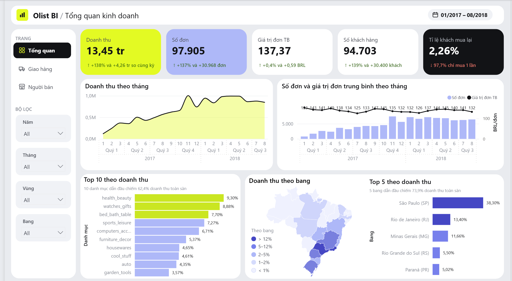
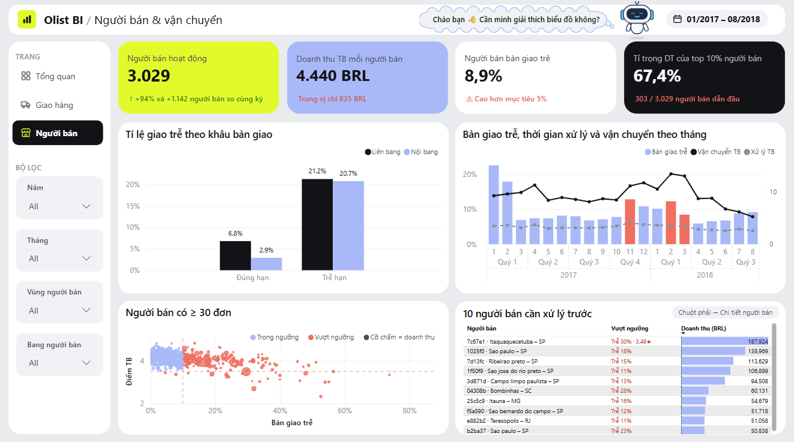

# Power BI – Semantic Model & Dashboard

> Yêu cầu và cách làm Semantic Model (BS-35): [docs/powerbi_rules.md](../docs/powerbi_rules.md). Đã làm gì, vì sao, dùng thế nào: [docs/semantic_model.md](../docs/semantic_model.md).

## Semantic Model

File: `powerbi/olist_dashboard.pbix` (cùng nội dung với file chung của nhóm trên OneDrive `Dashboard seminar [Group-3].pbix`). Power BI Desktop bản Microsoft Store 2.159.


### Relationships
> Model dựng bằng Power BI Project (TMDL), nạp `dds` ở chế độ Import qua `PostgreSQL.Database("localhost:5432", "olist_dw")`, không biến đổi gì trong Power Query. Tắt *Auto date/time* và *Autodetect relationships*.

| # | Từ (Fact) | Đến (Dimension) | Cardinality | Hướng lọc | Trạng thái |
|---|-----------|-----------------|-------------|-----------|------------|
| 1 | `fact_sales[purchase_date_key]` | `dim_date[date_key]` | *:1 | Single | Active |
| 2 | `fact_sales[customer_key]` | `dim_customer[customer_key]` | *:1 | Single | Active |
| 3 | `fact_sales[geography_key]` | `dim_geography[geography_key]` | *:1 | Single | Active |
| 4 | `fact_sales[product_key]` | `dim_product[product_key]` | *:1 | Single | Active |
| 5 | `fact_sales[seller_key]` | `dim_seller[seller_key]` | *:1 | Single | Active |
| 6 | `fact_delivery[purchase_date_key]` | `dim_date[date_key]` | *:1 | Single | Active |
| 7 | `fact_delivery[customer_key]` | `dim_customer[customer_key]` | *:1 | Single | Active |
| 8 | `fact_delivery[geography_key]` | `dim_geography[geography_key]` | *:1 | Single | Active |
| 9 | `fact_delivery[seller_key]` | `dim_seller[seller_key]` | *:1 | Single | Active |
| 10 | `fact_delivery[delivery_status_key]` | `dim_delivery_status[delivery_status_key]` | *:1 | Single | Active |
| 11 | `fact_review[purchase_date_key]` | `dim_date[date_key]` | *:1 | Single | Active |
| 12 | `fact_review[answer_date_key]` | `dim_date[date_key]` | *:1 | Single | **Inactive** (ngày trả lời đánh giá – dùng `USERELATIONSHIP`) |
| 13 | `fact_review[customer_key]` | `dim_customer[customer_key]` | *:1 | Single | Active |
| 14 | `fact_review[geography_key]` | `dim_geography[geography_key]` | *:1 | Single | Active |
| 15 | `fact_review[seller_key]` | `dim_seller[seller_key]` | *:1 | Single | Active |
| 16 | `fact_review[delivery_status_key]` | `dim_delivery_status[delivery_status_key]` | *:1 | Single | Active |

15 quan hệ Active + 1 Inactive; không có quan hệ 2 chiều, không có nhiều–nhiều. `dim_date` được đánh dấu *Mark as date table* (cột `full_date`).

### Hierarchies
| Dimension | Hierarchy | Các cấp |
|-----------|-----------|---------|
| `dim_date` | Năm - Quý - Tháng - Ngày | `year` → `quarter` → `month_name` → `full_date` |
| `dim_geography` | Vùng - Bang - Thành phố | `region` → `state_code` → `city` |
| `dim_seller` | Vùng - Bang - Thành phố | `seller_region` → `seller_state` → `seller_city` |
| `dim_delivery_status` | Kết quả giao - Nhóm số ngày trễ | `delivery_result` → `delay_bucket` |
| `dim_customer` | Vùng - Bang - Thành phố | `customer_region` → `customer_state` → `customer_city` (bang **hiện tại** của khách, SCD 1) |

### Cột sắp xếp (Sort by column)
Cột chữ mặc định sắp theo bảng chữ cái → cần một cột số làm thứ tự: chọn cột chữ → *Column tools* → *Sort by column* → chọn cột số, rồi ẩn cột số khỏi report view.

| Bảng | Cột hiển thị | Sắp theo | Cột sắp xếp lấy từ |
|---|---|---|---|
| `dim_delivery_status` | `delay_bucket` | `delay_bucket_order` | Cột tính toán DAX bên dưới – **không có trong `dds`** (quyết định 17/10/2026, `docs/decisions.md`) |
| `dim_date` | `month_name` | `month` | Có sẵn trong `dds` |
| `dim_date` | `day_name` | `day_of_week` | Có sẵn trong `dds` |

```dax
delay_bucket_order =
MOD ( dim_delivery_status[delivery_status_key] - 1, 7 ) + 1
```

> **Vì sao tính từ khóa mà không dùng `SWITCH` trên `delay_bucket`:** Power BI không cho cột dùng để sắp xếp (`delay_bucket`) phụ thuộc vào cột sắp xếp (`delay_bucket_order`) – nếu công thức đọc `delay_bucket` thì khi Refresh báo lỗi *circular dependency*. Dùng `delivery_status_key` thì không còn vòng lặp.
> `delivery_status_key` do dbt đánh số theo thứ tự `order_status` → `handover_status` → `route_type` → `delay_bucket`, trong đó 7 nhóm `delay_bucket` nằm ở vị trí trong cùng nên lặp lại 1…7 (Đúng hạn, Trễ 1–3, Trễ 4–7, Trễ 8–14, Trễ > 14, Chưa giao, Không xác định).
> ⚠ Công thức **phụ thuộc thứ tự các danh sách trong `dbt/models/marts/dim_delivery_status.sql`**: đổi thứ tự, thêm hoặc bớt nhóm `delay_bucket` ở dbt thì phải sửa số `7` (và kiểm tra lại) ở đây.
> Kiểm tra nhanh: tạo bảng gồm `delay_bucket` + `delay_bucket_order` – phải ra đúng 1–7 theo thứ tự Đúng hạn → Trễ 1–3 → Trễ 4–7 → Trễ 8–14 → Trễ > 14 → Chưa giao → Không xác định.

### Measures (DAX)
> Toàn bộ DAX được sao lưu trong `measures.dax`.

20 measure trong bảng `_Measures` (18 KPI / measure bổ trợ + 2 measure phụ). Mô tả đầy đủ nằm ở ô *Description* của từng measure; định nghĩa nghiệp vụ: [business_questions.md](../docs/business_questions.md) mục 6.

| Measure | Mã | Thư mục | Mô tả ngắn | Dùng ở trang |
|---------|----|---------|-----------|--------------|
| `Doanh thu` | K1 | 1 Tổng quan | Tổng giá trị hàng bán của đơn hợp lệ, không gồm phí vận chuyển | 1 (thẻ, Q1, Q2); 3 (Q6) |
| `Số đơn` | K2 | 1 Tổng quan | Số đơn hợp lệ (`DISTINCTCOUNT(order_id)`) | 1 (thẻ, Q1); 3 (Q6, M5) |
| `Giá trị đơn TB` | K3 | 1 Tổng quan | Giá trị đơn trung bình (AOV) = K1 / K2 | 1 (thẻ, Q1) |
| `Số khách hàng` | K4 | 1 Tổng quan | Số khách thực có đơn hợp lệ trong kỳ | 1 (thẻ) |
| `Tỉ lệ khách mua lại` | K5 | 1 Tổng quan | % khách có từ 2 lần mua trở lên trong kỳ | 1 (thẻ) |
| `Doanh thu cùng kỳ` | M1 | 1 Tổng quan | Doanh thu cùng kỳ năm trước; chỉ có giá trị với 01–08/2018 | 1 (Q1, tooltip) |
| `% tăng trưởng cùng kỳ` | M2 | 1 Tổng quan | (K1 − M1) / M1; BLANK khi M1 BLANK | 1 (thẻ K1, Q1) |
| `% tổng doanh thu` | M3 | 1 Tổng quan | Tỉ trọng doanh thu, bỏ lọc danh mục và bang | 1 (Q2) |
| `Số đơn giao trễ` | phụ | 0 Phụ | Tử số K6 (đơn có `delivery_result` = "Trễ hạn") | – (dùng trong K6) |
| `Số đơn đã giao` | phụ | 0 Phụ | Mẫu số K6 ("Đúng hạn" + "Trễ hạn") | – (dùng trong K6) |
| `Tỉ lệ giao trễ` | K6 | 2 Giao hàng | % đơn đã giao mà khách nhận sau ngày dự kiến | 2 (thẻ, Q3, Q4); 3 (Q5) |
| `Thời gian giao TB` | K7 | 2 Giao hàng | Số ngày từ lúc đặt đến lúc khách nhận (mỗi đơn 1 lần) | 2 (thẻ) |
| `Điểm đánh giá TB` | K8 | 2 Giao hàng | Điểm hài lòng trung bình, 1 điểm / đơn | 2 (thẻ, Q4); 3 (Q6) |
| `Tỉ lệ đánh giá tiêu cực` | K9 | 2 Giao hàng | % đơn bị đánh giá 1–2 sao | 2 (thẻ) |
| `Số người bán hoạt động` | K10 | 3 Người bán | Số người bán có ≥ 1 đơn hợp lệ (đếm trên fact) | 3 (thẻ) |
| `Doanh thu TB mỗi người bán` | K11 | 3 Người bán | K1 / K10 | 3 (thẻ) |
| `Tỉ lệ bàn giao trễ` | K12 | 3 Người bán | % lượt (đơn, người bán) bàn giao sau hạn | 3 (thẻ, Q5, Q6) |
| `Tỷ trọng doanh thu top 10% người bán` | K13 | 3 Người bán | Doanh thu của 10% người bán dẫn đầu / K1 (`ROUNDUP`) | 3 (thẻ) |
| `Thời gian vận chuyển TB` | M4 | 3 Người bán | Số ngày từ bàn giao đến khi khách nhận (mỗi đơn 1 lần) | 3 (Q5) |
| `Cờ người bán cần xử lý` | M5 | 3 Người bán | 1 nếu ≥ 30 đơn và (K8 < 3,5 hoặc K12 > 10%) | 3 (Q6, trang ẩn Chi tiết người bán) |

### Nghiệm thu B6 (đo ngày 29/10/2026)
`dds` đủ 10 batch (`etl_log` run_id 66 = batch `2018-09+`), model Import từ Postgres; kiểm bằng truy vấn DAX tự động vào engine của Power BI Desktop, đối chiếu thêm với SQL tính thẳng trên `dds`. Lọc `dim_date[is_analysis_period] = TRUE` (01/2017 – 08/2018) trừ khi ghi "bỏ lọc".

| KPI | Phải ra | Power BI ra | Ghi chú |
|---|---|---|---|
| K1 Doanh thu | 13.449.529,68 (bỏ lọc 13.494.400,74) | 13.449.529,68 (bỏ lọc 13.494.400,74) | Khớp SQL `dds` |
| K2 Số đơn | 97.905 | 97.905 | Khớp |
| K3 Giá trị đơn TB | ≈ 137,4 | 137,37 | Khớp |
| K4 Số khách hàng | ≈ 94.707 | 94.703 | Lệch 4 so với số CSV sơ bộ; `dds` / SQL cũng ra 94.703 → số đúng của `dds` |
| K5 Tỉ lệ khách mua lại | 2,27% | 2,26% (bỏ lọc 2,27%) | 2,27% là số bỏ lọc; trong kỳ là 2,265% |
| K6 Tỉ lệ giao trễ | 6.531 / 96.203 = 6,79% (bỏ lọc 6.534 / 96.470 = 6,77%) | 6.531 / 96.203 = 6,79% (bỏ lọc 6.534 / 96.470 = 6,77%) | Khớp từng đơn |
| K7 Thời gian giao TB | ≈ 12,5 ngày | 12,54 (bỏ lọc 12,56) | Khớp |
| K8 Điểm đánh giá TB | 4,09 | 4,089 (bỏ lọc 4,086) | Khớp |
| K9 Tỉ lệ đánh giá tiêu cực | 14,63% (bỏ lọc 14,69%) | 14,63% (bỏ lọc 14,69%) | Khớp |
| K10 Số người bán hoạt động | ≈ 3.029 | 3.029 (bỏ lọc 3.053) | Khớp |
| K11 Doanh thu TB mỗi người bán | ≈ 4.440 | 4.440,25 | Khớp |
| K12 Tỉ lệ bàn giao trễ | 8.913 / 98.824 = 9,02% (bỏ lọc) | bỏ lọc 9,02%; trong kỳ 8,90% | Khớp số bỏ lọc |
| K13 Tỷ trọng top 10% người bán | ≈ 67,3% | 67,38% (bỏ lọc 67,50%) | `ROUNDUP` = `ROUND` trong kỳ (cùng 303 người bán) – xem `decisions.md` 29/10/2026 |
| M4 Thời gian vận chuyển TB | ≈ 9,33 | 9,34 (bỏ lọc 9,33) | Khớp |

| Câu | Phải thấy | Power BI ra | Ghi chú |
|---|---|---|---|
| Q1 | 01–08: 3,08 → 7,34 tr BRL (+138%); 22.562 → 53.530 đơn; AOV 136,6 → 137,1 | 3.080.850,81 → 7.341.037,41 (M2 = +138,3%); 22.562 → 53.530; 136,55 → 137,14; đỉnh 11/2017 (1.003.862) | Khớp |
| Q2 | SP 38,3%, RJ 13,4%, MG 11,7%, RS 5,5%, PR 5,0%; health_beauty 9,3% | 38,30%, 13,40%, 11,66%, 5,50%, 5,02%; health_beauty 9,30% | Khớp |
| Q3 | 11/2017 12,4%; 02/2018 14,1%; 03/2018 19,0%; AL 21,5% | 12,40%; 14,13%; 18,96%; AL 21,46% | Khớp (chỉ 3 tháng vượt 10%) |
| Q4 | Đúng hạn 4,29★; trễ 2,27★; trễ 1–3 ngày 3,29★ | 4,29; 2,27; 3,29 (trễ 4–7: 2,10; 8–14: 1,67; > 14: 1,72) | Khớp |
| Q5 | Bàn giao trễ → 21,0% đơn giao trễ; đúng hạn → 5,3% | 21,08% và 5,39% | Lệch nhỏ so với số CSV sơ bộ (làm tròn / cách đếm); số của `dds` là 21,1% và 5,4%. Nhóm "Chưa bàn giao" ra 100% vì chỉ có 1 đơn delivered thiếu ngày bàn giao (dữ liệu nguồn) |
| Q6 | 191 / 633 người bán (≥ 30 đơn) có M5 = 1 | 191 / 633 | Khớp |

### Kiểm thử B7
| # | Kịch bản | Kết quả |
|---|---|---|
| 1 | `year_month` + K1, K2, K6, K8 | **Đạt.** 20 tháng 01/2017 – 08/2018; dòng Total = K1 13.449.529,68 / K2 97.905 / K6 6,79% / K8 4,089 (bằng số B6, không phải tổng các tháng) |
| 2 | `delay_bucket` + K8 | **Đạt.** Thứ tự Đúng hạn → Trễ 1–3 → Trễ 4–7 → Trễ 8–14 → Trễ > 14 → Chưa giao → Không xác định; `delay_bucket_order` = 1–7, 0 dòng lệch so với bảng đối chiếu |
| 3 | Người bán ≥ 30 đơn + M5 | **Đạt.** 633 người bán, 191 dòng M5 = 1 |
| 4 | Lọc 1 bang | **Đạt.** SP: doanh thu 5.163.867, trễ 4,49%, điểm 4,17; AL: 80.315, 21,41%, 3,76 – cả 3 fact đổi theo |
| 5 | Lọc 1 danh mục | **Đạt.** `health_beauty`: K1, K2 đổi (1.255.695 / 8.800); K6 6,77% và K8 4,086 **không đổi** (đúng thiết kế, B3) |
| 6 | M2 theo `month`, legend `year` | **Đạt.** Chỉ có giá trị 01–08/2018; 2016, 2017 và 09–12/2018 BLANK; ở mức ky 01/2017 – 08/2018 M1 = BLANK |
| 7 | Chạy lại pipeline (`rerun_last`) → Refresh | **Đạt.** `etl_log` run_id 96 `SUCCESS` (lại batch `2018-09+`, `dbt build` PASS=177); md5 cả 9 bảng `dds` trước / sau giống hệt; Refresh Full trong Power BI không lỗi, số dòng 9 bảng và mọi số B6 / B7 không đổi |

## Dashboard

> Câu hỏi, KPI và measure: [docs/business_questions.md](../docs/business_questions.md) mục 5–6.
> Số trên thẻ KPI trong phác thảo là số kiểm chứng sơ bộ trên CSV gốc (01/2017 – 08/2018), chỉ để minh họa.

**Nguyên tắc bố cục (áp dụng cho cả 3 trang)**
- Khung 16:9. Từ trên xuống: tiêu đề + slicer → hàng thẻ KPI → 2 câu hỏi, mỗi câu 1 hàng gồm 2 biểu đồ đặt cạnh nhau.
- Biểu đồ trái = **hiện tượng**, biểu đồ phải = **giải thích / khoanh vùng**; tiêu đề mỗi hàng ghi câu hỏi (Q1…).
- 1 màu chính cho mọi biểu đồ; **đỏ chỉ dùng cho cảnh báo** (vượt ngưỡng); xám cho đường tham chiếu/ngưỡng.
- Slicer dùng chung cho cả trang; click vào 1 biểu đồ sẽ lọc chéo các biểu đồ còn lại.

### Trang 1 – Tổng quan kinh doanh (Descriptive)

```
┌─────────────────────────────────────────────────────────────────────────────┐
│ TỔNG QUAN KINH DOANH                     [Năm ▼] [Tháng ▼] [Vùng ▼] [Bang ▼] │
├──────────────┬──────────────┬──────────────┬──────────────┬─────────────────┤
│ DOANH THU    │ SỐ ĐƠN       │ GIÁ TRỊ ĐƠN TB│ SỐ KHÁCH HÀNG│ KHÁCH MUA LẠI   │
│ 13,45 tr BRL │ 97.905       │ 137 BRL      │ 94.707       │ 2,3%            │
│ ▲ x% cùng kỳ │ ▲ x% cùng kỳ │              │              │                 │
├──────────────┴──────────────┴──────────────┴──────────────┴─────────────────┤
│ Q1. Doanh thu tăng bao nhiêu so với cùng kỳ, và tăng nhờ số đơn hay giá trị đơn?│
├──────────────────────────────────────┬──────────────────────────────────────┤
│ (1) Doanh thu theo tháng 2018 vs 2017│ (2) Số đơn (cột) và AOV (đường)       │
│  tr│        2017 ·····  2018 ────    │  đơn│              ▄█▄ ▄▄█▄▄▄▄▄  ─ 137 │
│ 1,0│  ───────────╮      ·            │     │        ▄▄▄██████████████  BRL  │
│ 0,5│             ╰──  ····╮          │     │ ─────────────────────────────  │
│    │ ·····                ·····      │     │ ▄▄▄██████████████████████████  │
│    └─1──2──3──4──5──6──7──8──9─...12 │     └─T1/17 ─────────────── T8/18  │
├──────────────────────────────────────┴──────────────────────────────────────┤
│ Q2. Danh mục và bang nào đóng góp doanh thu nhiều nhất?                      │
├──────────────────────────────────────┬──────────────────────────────────────┤
│ (1) Top 10 danh mục theo doanh thu   │ (2) Doanh thu theo bang              │
│ health_beauty   ██████████ 9,3%      │          ░░▒▒                        │
│ watches_gifts   █████████  8,9%      │         ▒▒▓▓█  <- SP 38%             │
│ bed_bath_table  ████████   7,7%      │          ▒▓▓                         │
│ ...                                  │   (click 1 bang → (1) lọc theo bang) │
└──────────────────────────────────────┴──────────────────────────────────────┘
```

| Câu | Biểu đồ | Visual Power BI | Trục / giá trị |
|---|---|---|---|
| Q1 | (1) | Line chart | X = tháng (1–12), Legend = năm, Y = Doanh thu; tooltip: % YoY |
| Q1 | (2) | Line and clustered column chart | X = tháng (01/2017 – 08/2018), cột = Số đơn, đường = AOV (trục phụ) |
| Q2 | (1) | Clustered bar chart | Y = danh mục (Top N = 10), X = Doanh thu; nhãn = % tổng doanh thu |
| Q2 | (2) | Filled map (hoặc bar chart theo bang nếu map lỗi) | Location = bang, Color saturation = Doanh thu; hierarchy Vùng → Bang |

### Trang 2 – Giao hàng & trải nghiệm khách hàng (Diagnostic)

```
┌─────────────────────────────────────────────────────────────────────────────┐
│ GIAO HÀNG & TRẢI NGHIỆM KHÁCH HÀNG                [Năm ▼] [Tháng ▼] [Vùng ▼] │
├───────────────────┬───────────────────┬───────────────────┬─────────────────┤
│ TỈ LỆ GIAO TRỄ    │ THỜI GIAN GIAO TB │ ĐIỂM ĐÁNH GIÁ TB  │ ĐÁNH GIÁ 1–2 ★  │
│ 6,8%              │ 12,5 ngày         │ 4,09 ★            │ 14,6%           │
├───────────────────┴───────────────────┴───────────────────┴─────────────────┤
│ Q3. Tháng nào giao trễ vượt 10%, bang nào trễ nhiều nhất?                    │
├──────────────────────────────────────┬──────────────────────────────────────┤
│ (1) Tỉ lệ giao trễ theo tháng        │ (2) Tỉ lệ giao trễ theo bang         │
│  % │                 ● 19%           │ AL  ███████████ 21,5%  (đỏ > 10%)    │
│ 10 │- - - - - -●- - - - - - ngưỡng   │ MA  █████████   17,5%                │
│  5 │ ──────╯ ╰─╯  ╰─────╮ ╭─         │ SE  ████████    15,4%                │
│    └─T1/17 ──────────────── T8/18    │ ... (click tháng ở (1) → lọc (2))    │
├──────────────────────────────────────┴──────────────────────────────────────┤
│ Q4. Giao trễ làm điểm đánh giá giảm bao nhiêu?                               │
├──────────────────────────────────────┬──────────────────────────────────────┤
│ (1) Điểm TB theo mức giao trễ        │ (2) Tỉ lệ trễ và điểm TB theo tháng   │
│ ★ ███ 4,3  - - - - - - TB sàn 4,09   │  % │      ╭╮   ╭─╮    ── tỉ lệ trễ  ★ │
│   ███ ███ 3,3                        │    │ ─────╯╰───╯ ╰──── ·· điểm TB    │
│   ███ ███ ███ 2,1 ▄▄▄ 1,7 ▄▄▄ 1,7    │    │ ·····╮╭···╮ ╭···· (đi ngược    │
│   Đúng 1–3 4–7  8–14   >14 ngày      │    │      ╰╯   ╰─╯     nhau)        │
│   hạn                                │    └─T1/17 ──────────────── T8/18    │
└──────────────────────────────────────┴──────────────────────────────────────┘
```

| Câu | Biểu đồ | Visual Power BI | Trục / giá trị |
|---|---|---|---|
| Q3 | (1) | Line chart + constant line 10% | X = tháng, Y = Tỉ lệ giao trễ |
| Q3 | (2) | Clustered bar chart, sắp giảm dần | Y = bang, X = Tỉ lệ giao trễ; conditional formatting đỏ khi > 10% |
| Q4 | (1) | Clustered column chart + constant line | X = nhóm số ngày trễ, Y = Điểm TB |
| Q4 | (2) | Line chart 2 trục | X = tháng, Y = Tỉ lệ giao trễ, Secondary Y = Điểm TB |

### Trang 3 – Người bán & vận chuyển (Diagnostic)

```
┌─────────────────────────────────────────────────────────────────────────────┐
│ NGƯỜI BÁN & VẬN CHUYỂN                   [Năm ▼] [Tháng ▼] [Bang NB ▼]       │
├───────────────────┬───────────────────┬───────────────────┬─────────────────┤
│ NGƯỜI BÁN H.ĐỘNG  │ DT TB / NGƯỜI BÁN │ NB BÀN GIAO TRỄ   │ TOP 10% NB      │
│ 3.029             │ 4.440 BRL         │ 8,9%              │ 67,3% doanh thu │
├───────────────────┴───────────────────┴───────────────────┴─────────────────┤
│ Q5. Giao trễ do người bán bàn giao chậm hay do vận chuyển?                    │
├──────────────────────────────────────┬──────────────────────────────────────┤
│ (1) Tỉ lệ giao trễ theo khâu bàn giao│ (2) Bàn giao trễ và thời gian vận     │
│  % │       ▓ nội bang  ░ liên bang   │     chuyển theo tháng                 │
│ 21 │              ▓▓ ░░              │  % │ ── NB bàn giao trễ   ·· ngày VC  │
│  7 │        ░░    ▓▓ ░░              │ 12 │ ─────────────────── (đi ngang)  │
│  3 │     ▓▓ ░░    ▓▓ ░░              │    │      ···    ·····  13 ngày      │
│    └ Bàn giao     Bàn giao           │    │ ·····   ····     ···· (tăng vọt │
│      đúng hạn     trễ                │    └─T1/17 ──────── T8/18  02–03/18) │
├──────────────────────────────────────┴──────────────────────────────────────┤
│ Q6. Người bán nào cần ưu tiên xử lý?                                         │
├──────────────────────────────────────┬──────────────────────────────────────┤
│ (1) Người bán ≥ 30 đơn               │ (2) Top 10 NB vượt ngưỡng theo DT     │
│ ★ 5 │ ○ ○○ ○  ┊                      │ NB #1    ██████████                  │
│     │ ○○○ ○   ┊   ○                  │ NB #2    ████████                    │
│ 3,5 │- - - - -┼- - - - -             │ NB #3    ███████                     │
│     │    ○    ┊ ●  ● <- cần xử lý    │ ...                                  │
│   1 └─────────┴──────── % bàn giao trễ│ (chuột phải → Chi tiết người bán)    │
│       0%     10%                     │                                      │
└──────────────────────────────────────┴──────────────────────────────────────┘
```

| Câu | Biểu đồ | Visual Power BI | Trục / giá trị |
|---|---|---|---|
| Q5 | (1) | Clustered column chart | X = người bán bàn giao đúng hạn / trễ, Legend = nội bang / liên bang, Y = Tỉ lệ giao trễ |
| Q5 | (2) | Line chart 2 trục | X = tháng, Y = Tỉ lệ người bán bàn giao trễ, Secondary Y = Thời gian vận chuyển TB (M4) |
| Q6 | (1) | Scatter chart + 2 constant line | Values = seller, X = Tỉ lệ bàn giao trễ, Y = Điểm TB, Size = Doanh thu; filter: số đơn ≥ 30 |
| Q6 | (2) | Clustered bar chart | Y = seller (Top N = 10 theo Doanh thu), X = Doanh thu; filter M5 = 1; tooltip: Điểm TB, % bàn giao trễ |

**Trang ẩn "Chi tiết người bán"** (drill-through, không tính vào 3 trang chính): thẻ doanh thu, số đơn, điểm TB, tỉ lệ bàn giao trễ
của 1 người bán + biểu đồ đường điểm TB theo tháng + bảng danh mục người bán đó đang bán.

## Ảnh chụp



