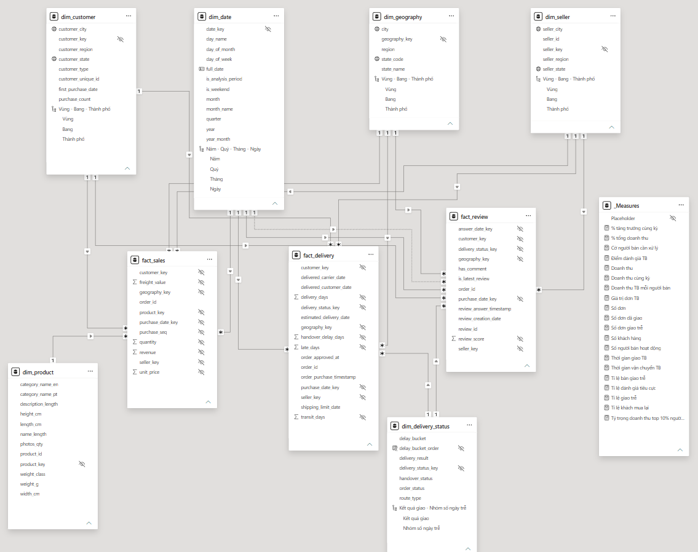
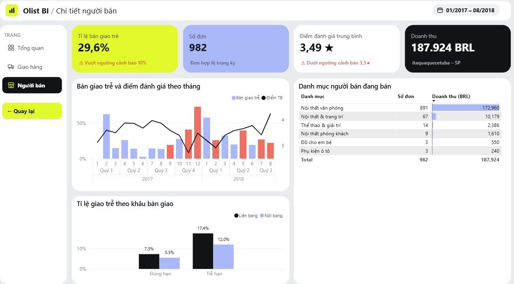

# Power BI – Semantic Model & Dashboard

> Yêu cầu và cách làm Semantic Model (BS-35): [docs/powerbi_rules.md](../docs/powerbi_rules.md). Đã làm gì, vì sao, dùng thế nào: [docs/semantic_model.md](../docs/semantic_model.md).

## Semantic Model

File: `Dashboard seminar [Group-3].pbix` trên OneDrive của nhóm (file `.pbix` ~29 MB, kèm dữ liệu, **không lên Git** – `.gitignore`; trong repo chỉ có `measures.dax` + tài liệu). Power BI Desktop bản Microsoft Store 2.159.



### Relationships
> Model dựng bằng Power BI Project (TMDL), nạp `dds` ở chế độ Import qua `PostgreSQL.Database("localhost:5432", "olist_dw")`, không biến đổi gì trong Power Query. Tắt *Auto date/time* và *Autodetect relationships*.

| # | Từ (Fact) | Đến (Dimension) | Cardinality | Hướng lọc | Trạng thái |
|---|-----------|-----------------|-------------|-----------|------------|
| 1 | `fact_sales[purchase_date_key]` | `dim_date[date_key]` | *:1 | Single | Active |
| 2 | `fact_sales[customer_key]` | `dim_customer[customer_key]` | *:1 | Single | Active |
| 3 | `fact_sales[geography_key]` | `dim_geography[geography_key]` | *:1 | Single | Active |
| 4 | `fact_sales[product_key]` | `dim_product[product_key]` | *:1 | Single | Active |
| 5 | `fact_sales[seller_key]` | `dim_seller[seller_key]` | *:1 | Single | Active |
| 6 | `fact_delivery[purchase_date_key]` | `dim_date[date_key]` | *:1 | Single | Active |
| 7 | `fact_delivery[customer_key]` | `dim_customer[customer_key]` | *:1 | Single | Active |
| 8 | `fact_delivery[geography_key]` | `dim_geography[geography_key]` | *:1 | Single | Active |
| 9 | `fact_delivery[seller_key]` | `dim_seller[seller_key]` | *:1 | Single | Active |
| 10 | `fact_delivery[delivery_status_key]` | `dim_delivery_status[delivery_status_key]` | *:1 | Single | Active |
| 11 | `fact_review[purchase_date_key]` | `dim_date[date_key]` | *:1 | Single | Active |
| 12 | `fact_review[answer_date_key]` | `dim_date[date_key]` | *:1 | Single | **Inactive** (ngày trả lời đánh giá – dùng `USERELATIONSHIP`) |
| 13 | `fact_review[customer_key]` | `dim_customer[customer_key]` | *:1 | Single | Active |
| 14 | `fact_review[geography_key]` | `dim_geography[geography_key]` | *:1 | Single | Active |
| 15 | `fact_review[seller_key]` | `dim_seller[seller_key]` | *:1 | Single | Active |
| 16 | `fact_review[delivery_status_key]` | `dim_delivery_status[delivery_status_key]` | *:1 | Single | Active |

15 quan hệ Active + 1 Inactive; không có quan hệ 2 chiều, không có nhiều–nhiều. `dim_date` được đánh dấu *Mark as date table* (cột `full_date`).

### Hierarchies
| Dimension | Hierarchy | Các cấp |
|-----------|-----------|---------|
| `dim_date` | Năm - Quý - Tháng - Ngày | `year` → `quarter` → `month_name` → `full_date` |
| `dim_geography` | Vùng - Bang - Thành phố | `region` → `state_code` → `city` |
| `dim_seller` | Vùng - Bang - Thành phố | `seller_region` → `seller_state` → `seller_city` |
| `dim_delivery_status` | Kết quả giao - Nhóm số ngày trễ | `delivery_result` → `delay_bucket` |
| `dim_customer` | Vùng - Bang - Thành phố | `customer_region` → `customer_state` → `customer_city` (bang **hiện tại** của khách, SCD 1) |

### Cột sắp xếp (Sort by column)
Cột chữ mặc định sắp theo bảng chữ cái → cần một cột số làm thứ tự: chọn cột chữ → *Column tools* → *Sort by column* → chọn cột số, rồi ẩn cột số khỏi report view.

| Bảng | Cột hiển thị | Sắp theo | Cột sắp xếp lấy từ |
|---|---|---|---|
| `dim_delivery_status` | `delay_bucket` | `delay_bucket_order` | Cột tính toán DAX bên dưới – **không có trong `dds`** (quyết định 17/10/2026, `docs/decisions.md`) |
| `dim_date` | `month_name` | `month` | Có sẵn trong `dds` |
| `dim_date` | `day_name` | `day_of_week` | Có sẵn trong `dds` |

```dax
delay_bucket_order =
MOD ( dim_delivery_status[delivery_status_key] - 1, 7 ) + 1
```

> **Vì sao tính từ khóa mà không dùng `SWITCH` trên `delay_bucket`:** Power BI không cho cột dùng để sắp xếp (`delay_bucket`) phụ thuộc vào cột sắp xếp (`delay_bucket_order`) – nếu công thức đọc `delay_bucket` thì khi Refresh báo lỗi *circular dependency*. Dùng `delivery_status_key` thì không còn vòng lặp.
> `delivery_status_key` do dbt đánh số theo thứ tự `order_status` → `handover_status` → `route_type` → `delay_bucket`, trong đó 7 nhóm `delay_bucket` nằm ở vị trí trong cùng nên lặp lại 1…7 (Đúng hạn, Trễ 1–3, Trễ 4–7, Trễ 8–14, Trễ > 14, Chưa giao, Không xác định).
> ⚠ Công thức **phụ thuộc thứ tự các danh sách trong `dbt/models/marts/dim_delivery_status.sql`**: đổi thứ tự, thêm hoặc bớt nhóm `delay_bucket` ở dbt thì phải sửa số `7` (và kiểm tra lại) ở đây.
> Kiểm tra nhanh: tạo bảng gồm `delay_bucket` + `delay_bucket_order` – phải ra đúng 1–7 theo thứ tự Đúng hạn → Trễ 1–3 → Trễ 4–7 → Trễ 8–14 → Trễ > 14 → Chưa giao → Không xác định.

### Cột tính thêm cho trang 3
Hai cột chỉ để hiển thị, không có trong `dds`; công thức đầy đủ ở đầu `measures.dax`.

| Cột | Công thức | Dùng ở |
|---|---|---|
| `dim_seller[seller_label]` | 6 ký tự đầu `seller_id` · thành phố – bang; dòng -1 = "Không xác định". Olist ẩn danh người bán nên không có tên cửa hàng; 6 ký tự đầu không trùng giữa 3.096 người bán | Scatter Q6, bảng top 10, trường drill-through của trang ẩn |
| `dim_product[category_name_vi]` | `SWITCH` 74 bản dịch tay từ `category_name_en`; danh mục chưa có bản dịch giữ tiếng Anh | Bảng danh mục ở trang ẩn Chi tiết người bán |

### Measures (DAX)
> Toàn bộ DAX được sao lưu trong `measures.dax`.

99 measure trong bảng `_Measures` (đếm lại 05/11/2026 sau khi thêm 2 measure trang 3 theo yêu cầu mục 3.1.3):
- 33 measure ở thư mục chính `0 Phụ`, `1 Tổng quan`, `2 Giao hàng`, `3 Người bán` – liệt kê ở bảng dưới, trừ `Điểm TB toàn sàn` (K8 bỏ lọc trạng thái giao hàng, đường TB sàn trang 2);
- 3 measure ở thư mục `Hỏi AI` (`Link hỏi AI trang 1..3` – link của nút trợ lý AI trên header, mục Nút trợ lý AI bên dưới);
- 63 measure hiển thị ở thư mục con `Thẻ KPI` (số và dòng phụ trên thẻ, dạng chữ), `Định dạng` (màu theo ngưỡng) và `Tiêu đề` (câu kết luận Q5, Q6 – còn trong model nhưng không gắn vào biểu đồ). Không dùng trong công thức khác.

Mô tả đầy đủ nằm ở ô *Description* của từng measure; định nghĩa nghiệp vụ: [business_questions.md](../docs/business_questions.md) mục 6.

| Measure | Mã | Thư mục | Mô tả ngắn | Dùng ở trang |
|---------|----|---------|-----------|--------------|
| `Doanh thu` | K1 | 1 Tổng quan | Tổng giá trị hàng bán của đơn hợp lệ, không gồm phí vận chuyển | 1 (thẻ, Q1, Q2); 3 (Q6) |
| `Số đơn` | K2 | 1 Tổng quan | Số đơn hợp lệ (`DISTINCTCOUNT(order_id)`) | 1 (thẻ, Q1); 3 (Q6, M5) |
| `Giá trị đơn TB` | K3 | 1 Tổng quan | Giá trị đơn trung bình (AOV) = K1 / K2 | 1 (thẻ, Q1) |
| `Số khách hàng` | K4 | 1 Tổng quan | Số khách thực có đơn hợp lệ trong kỳ | 1 (thẻ) |
| `Tỉ lệ khách mua lại` | K5 | 1 Tổng quan | % khách có từ 2 lần mua trở lên trong kỳ | 1 (thẻ) |
| `Doanh thu cùng kỳ` | M1 | 1 Tổng quan | Doanh thu cùng kỳ năm trước; chỉ có giá trị với 01–08/2018 | 1 (Q1, tooltip) |
| `% tăng trưởng cùng kỳ` | M2 | 1 Tổng quan | (K1 − M1) / M1; BLANK khi M1 BLANK | 1 (thẻ K1, Q1) |
| `% tổng doanh thu` | M3 | 1 Tổng quan | Tỉ trọng doanh thu, bỏ lọc danh mục và bang | 1 (Q2) |
| `Số đơn giao trễ` | phụ | 0 Phụ | Tử số K6 (đơn có `delivery_result` = "Trễ hạn") | – (dùng trong K6) |
| `Số đơn đã giao` | phụ | 0 Phụ | Mẫu số K6 ("Đúng hạn" + "Trễ hạn") | – (dùng trong K6) |
| `Tỉ lệ giao trễ` | K6 | 2 Giao hàng | % đơn đã giao mà khách nhận sau ngày dự kiến | 2 (thẻ, Q3, Q4); 3 (Q5) |
| `Thời gian giao TB` | K7 | 2 Giao hàng | Số ngày từ lúc đặt đến lúc khách nhận (mỗi đơn 1 lần) | 2 (thẻ) |
| `Điểm đánh giá TB` | K8 | 2 Giao hàng | Điểm hài lòng trung bình, 1 điểm / đơn | 2 (thẻ, Q4); 3 (Q6) |
| `Tỉ lệ đánh giá tiêu cực` | K9 | 2 Giao hàng | % đơn bị đánh giá 1–2 sao | 2 (thẻ) |
| `Số lượt đánh giá` | Q4 | 2 Giao hàng | Số đơn có đánh giá (1 lượt / đơn, đánh giá mới nhất) – mẫu số của K8 | 2 (tooltip điểm theo mức trễ) |
| `Chênh lệch điểm trễ` | Q4 | 2 Giao hàng | Điểm TB đơn đúng hạn − điểm TB đơn giao trễ (2,02★ trong kỳ) | – (phụ đề `Phụ đề điểm theo mức trễ`) |
| `Số người bán hoạt động` | K10 | 3 Người bán | Số người bán có ≥ 1 đơn hợp lệ (đếm trên fact) | 3 (thẻ) |
| `Doanh thu TB mỗi người bán` | K11 | 3 Người bán | K1 / K10 | 3 (thẻ) |
| `Tỉ lệ bàn giao trễ` | K12 | 3 Người bán | % lượt (đơn, người bán) bàn giao sau hạn | 3 (thẻ, Q5, Q6) |
| `Tỷ trọng doanh thu top 10% người bán` | K13 | 3 Người bán | Doanh thu của 10% người bán dẫn đầu / K1 (`ROUNDUP`) | 3 (thẻ) |
| `Thời gian vận chuyển TB` | M4 | 3 Người bán | Số ngày từ bàn giao đến khi khách nhận (mỗi đơn 1 lần) | 3 (Q5) |
| `Thời gian xử lý TB` | Q5 | 3 Người bán | Số ngày từ lúc đặt đến lúc người bán bàn giao = `delivery_days − transit_days` (mỗi đơn 1 lần, bỏ bàn giao "Không xác định"); cả kỳ 3,20 | 3 (Q5, đường nét đứt) |
| `Số lượt bàn giao trễ` | Q5 | 3 Người bán | Tử số K12: số lượt (đơn, người bán) bàn giao sau hạn; cả kỳ 8.773 | 3 (tooltip Q5) |
| `Cờ người bán cần xử lý` | M5 | 3 Người bán | 1 nếu ≥ 30 đơn và (K8 < 3,5 hoặc K12 > 10%) | 3 (Q6, trang ẩn Chi tiết người bán) |
| `Số người bán ≥ 30 đơn` | Q6 | 3 Người bán | Số người bán có từ 30 đơn hợp lệ trở lên | – (mẫu số `Tiêu đề Q6`) |
| `Số người bán cần xử lý` | Q6 | 3 Người bán | Số người bán có M5 = 1 | – (tử số `Tiêu đề Q6`) |
| `Doanh thu NB cần xử lý` | Q6 | 3 Người bán | Doanh thu của người bán có M5 = 1, BLANK với người bán trong ngưỡng | 3 (bảng top 10: Top N, data bar) |
| `Tỉ trọng doanh thu NB cần xử lý` | Q6 | 3 Người bán | Doanh thu NB cần xử lý / K1 (bỏ lọc `seller_id` ở mẫu số) | – (`Tiêu đề Q6`) |
| `Cảnh báo người bán` | Q6 | 3 Người bán | Ngưỡng bị vượt của 1 người bán, VD "Trễ 30% · 3,49★" | 3 (bảng top 10, tooltip scatter) |
| `Người bán đang xem` | – | 3 Người bán | Mã, thành phố, bang của người bán được drill-through | – (chưa gắn visual; trang ẩn dùng `Người bán ghi chú`) |

### Nghiệm thu B6 (đo ngày 29/10/2026)
`dds` đủ 10 batch (`etl_log` run_id 66 = batch `2018-09+`), model Import từ Postgres; kiểm bằng truy vấn DAX tự động vào engine của Power BI Desktop, đối chiếu thêm với SQL tính thẳng trên `dds`. Lọc `dim_date[is_analysis_period] = TRUE` (01/2017 – 08/2018) trừ khi ghi "bỏ lọc".

| KPI | Phải ra | Power BI ra | Ghi chú |
|---|---|---|---|
| K1 Doanh thu | 13.449.529,68 (bỏ lọc 13.494.400,74) | 13.449.529,68 (bỏ lọc 13.494.400,74) | Khớp SQL `dds` |
| K2 Số đơn | 97.905 | 97.905 | Khớp |
| K3 Giá trị đơn TB | ≈ 137,4 | 137,37 | Khớp |
| K4 Số khách hàng | ≈ 94.707 | 94.703 | Lệch 4 so với số CSV sơ bộ; `dds` / SQL cũng ra 94.703 → số đúng của `dds` |
| K5 Tỉ lệ khách mua lại | 2,27% | 2,26% (bỏ lọc 2,27%) | 2,27% là số bỏ lọc; trong kỳ là 2,265% |
| K6 Tỉ lệ giao trễ | 6.531 / 96.203 = 6,79% (bỏ lọc 6.534 / 96.470 = 6,77%) | 6.531 / 96.203 = 6,79% (bỏ lọc 6.534 / 96.470 = 6,77%) | Khớp từng đơn |
| K7 Thời gian giao TB | ≈ 12,5 ngày | 12,54 (bỏ lọc 12,56) | Khớp |
| K8 Điểm đánh giá TB | 4,09 | 4,089 (bỏ lọc 4,086) | Khớp |
| K9 Tỉ lệ đánh giá tiêu cực | 14,63% (bỏ lọc 14,69%) | 14,63% (bỏ lọc 14,69%) | Khớp |
| K10 Số người bán hoạt động | ≈ 3.029 | 3.029 (bỏ lọc 3.053) | Khớp |
| K11 Doanh thu TB mỗi người bán | ≈ 4.440 | 4.440,25 | Khớp |
| K12 Tỉ lệ bàn giao trễ | 8.913 / 98.824 = 9,02% (bỏ lọc) | bỏ lọc 9,02%; trong kỳ 8,90% | Khớp số bỏ lọc |
| K13 Tỷ trọng top 10% người bán | ≈ 67,3% | 67,38% (bỏ lọc 67,50%) | `ROUNDUP` = `ROUND` trong kỳ (cùng 303 người bán) – xem `decisions.md` 29/10/2026 |
| M4 Thời gian vận chuyển TB | ≈ 9,33 | 9,34 (bỏ lọc 9,33) | Khớp |

| Câu | Phải thấy | Power BI ra | Ghi chú |
|---|---|---|---|
| Q1 | 01–08: 3,08 → 7,34 tr BRL (+138%); 22.562 → 53.530 đơn; AOV 136,6 → 137,1 | 3.080.850,81 → 7.341.037,41 (M2 = +138,3%); 22.562 → 53.530; 136,55 → 137,14; đỉnh 11/2017 (1.003.862) | Khớp |
| Q2 | SP 38,3%, RJ 13,4%, MG 11,7%, RS 5,5%, PR 5,0%; health_beauty 9,3% | 38,30%, 13,40%, 11,66%, 5,50%, 5,02%; health_beauty 9,30% | Khớp |
| Q3 | 11/2017 12,4%; 02/2018 14,1%; 03/2018 19,0%; AL 21,5% | 12,40%; 14,13%; 18,96%; AL 21,46% | Khớp (chỉ 3 tháng vượt 10%) |
| Q4 | Đúng hạn 4,29★; trễ 2,27★; trễ 1–3 ngày 3,29★ | 4,29; 2,27; 3,29 (trễ 4–7: 2,10; 8–14: 1,67; > 14: 1,72) | Khớp |
| Q5 | Bàn giao trễ → 21,0% đơn giao trễ; đúng hạn → 5,3% | 21,08% và 5,39% | Lệch nhỏ so với số CSV sơ bộ (làm tròn / cách đếm); số của `dds` là 21,1% và 5,4%. Nhóm "Chưa bàn giao" ra 100% vì chỉ có 1 đơn delivered thiếu ngày bàn giao (dữ liệu nguồn) |
| Q6 | 191 / 633 người bán (≥ 30 đơn) có M5 = 1 | 191 / 633 | Khớp |

### Kiểm thử B7
| # | Kịch bản | Kết quả |
|---|---|---|
| 1 | `year_month` + K1, K2, K6, K8 | **Đạt.** 20 tháng 01/2017 – 08/2018; dòng Total = K1 13.449.529,68 / K2 97.905 / K6 6,79% / K8 4,089 (bằng số B6, không phải tổng các tháng) |
| 2 | `delay_bucket` + K8 | **Đạt.** Thứ tự Đúng hạn → Trễ 1–3 → Trễ 4–7 → Trễ 8–14 → Trễ > 14 → Chưa giao → Không xác định; `delay_bucket_order` = 1–7, 0 dòng lệch so với bảng đối chiếu |
| 3 | Người bán ≥ 30 đơn + M5 | **Đạt.** 633 người bán, 191 dòng M5 = 1 |
| 4 | Lọc 1 bang | **Đạt.** SP: doanh thu 5.163.867, trễ 4,49%, điểm 4,17; AL: 80.315, 21,41%, 3,76 – cả 3 fact đổi theo |
| 5 | Lọc 1 danh mục | **Đạt.** `health_beauty`: K1, K2 đổi (1.255.695 / 8.800); K6 6,77% và K8 4,086 **không đổi** (đúng thiết kế, B3) |
| 6 | M2 theo `month`, legend `year` | **Đạt.** Chỉ có giá trị 01–08/2018; 2016, 2017 và 09–12/2018 BLANK; ở mức ky 01/2017 – 08/2018 M1 = BLANK |
| 7 | Chạy lại pipeline (`rerun_last`) → Refresh | **Đạt.** `etl_log` run_id 96 `SUCCESS` (lại batch `2018-09+`, `dbt build` PASS=177); md5 cả 9 bảng `dds` trước / sau giống hệt; Refresh Full trong Power BI không lỗi, số dòng 9 bảng và mọi số B6 / B7 không đổi |

## Dashboard

> Câu hỏi, KPI và measure: [docs/business_questions.md](../docs/business_questions.md) mục 5–6. Phân tích và trả lời từng câu hỏi: báo cáo Chương 7.

File gồm 3 trang chính và 1 trang ẩn. Toàn báo cáo lọc `dim_date[is_analysis_period] = TRUE`, nên mọi số liệu thuộc giai đoạn 01/2017 – 08/2018.

**Nguyên tắc bố cục chung**
- Khung 16:9 gồm header (tên trang, kỳ phân tích, ảnh động trợ lý AI), thanh bên trái (3 nút chuyển trang và slicer), hàng thẻ KPI, 2 hàng biểu đồ; mỗi hàng biểu đồ trả lời 1 câu hỏi.
- Dòng phụ dưới thẻ KPI so với cùng kỳ (trang 1) hoặc với mục tiêu, ngưỡng cảnh báo (trang 2, 3); chữ và màu dòng phụ lấy từ measure.
- Màu theo `theme_olist.json`: vàng chanh, tím nhạt, đen là màu chính; đỏ chỉ dùng cho phần vượt ngưỡng cảnh báo; xám cho đường tham chiếu.
- Slicer Năm, Tháng đồng bộ cả 3 trang (`syncGroup`), chọn được nhiều giá trị. Bấm vào một biểu đồ sẽ lọc chéo các biểu đồ còn lại, trừ các cặp được tắt có chủ đích (ghi ở từng trang).
- Trục thời gian nhiều tầng Năm → Quý → Tháng, mặc định cấp Tháng, bấm ↑ để lên cấp Quý, Năm. Nút "Go to the next level" được ẩn vì nút này gộp cùng một tháng của hai năm thành một điểm.

### Trang 1 – Tổng quan kinh doanh (Descriptive)


Slicer: Năm, Tháng, Vùng, Bang (nơi nhận hàng). Thẻ KPI: K1 Doanh thu, K2 Số đơn, K3 Giá trị đơn TB, K4 Số khách hàng, K5 Tỉ lệ khách mua lại; dòng phụ so 01–08/2018 với cùng kỳ 2017 (xanh khi tăng, đỏ khi giảm).

| Câu | Biểu đồ | Visual Power BI | Trục / giá trị |
|---|---|---|---|
| Q1 | Doanh thu theo tháng | Area chart | X = Năm → Quý → Tháng, Y = Doanh thu |
| Q1 | Số đơn và giá trị đơn trung bình theo tháng | Line and clustered column chart | X = Năm → Quý → Tháng; cột = Số đơn, đường = Giá trị đơn TB (trục phải) |
| Q2 | Top 10 theo doanh thu | Clustered bar chart | Y = Danh mục → Mã sản phẩm (drill), X = `% tổng doanh thu`; Top 10 bằng measure `Lọc top 10 sản phẩm`; 3 danh mục đầu tô vàng chanh; phụ đề `Phụ đề top 10 danh mục` ("10 danh mục dẫn đầu chiếm 62,4% doanh thu toàn sàn") |
| Q2 | Doanh thu theo bang | Shape map (`maps/brazil_states.json`) và clustered bar chart "Top 5 theo doanh thu" | Bản đồ tô theo 5 nhóm tỉ trọng (`Nhóm tỉ trọng bang`); thanh Top 5 theo Vùng → Bang → Thành phố, mặc định cấp Bang, Top 5 bằng measure `Lọc top 5 địa lý`, phụ đề `Phụ đề top 5 bang` (73,9%) |

Top N làm bằng measure trả về giá trị trống ngoài nhóm dẫn đầu, không dùng bộ lọc Top N của visual: bộ lọc mức visual được tính ở cấp thấp nhất của trục drill, nên ở cấp Bang chỉ cộng doanh thu của 5 thành phố đầu (São Paulo ra 18,0% thay vì 38,3%). Biểu đồ 1 và 2 cùng trục tháng nên không lọc nhau.

### Trang 2 – Giao hàng & trải nghiệm khách hàng (Diagnostic)


Slicer: Năm, Tháng, Vùng. Thẻ KPI: K6 Tỉ lệ giao trễ (mục tiêu ≤ 5%, cảnh báo > 10%), K7 Thời gian giao TB, K8 Điểm đánh giá TB (mục tiêu ≥ 4,0★, cảnh báo < 3,5★), K9 Tỉ lệ đánh giá 1–2★ (mục tiêu ≤ 10%, cảnh báo > 20%).

| Câu | Biểu đồ | Visual Power BI | Trục / giá trị |
|---|---|---|---|
| Q3 | Tỉ lệ giao trễ theo tháng | Area chart và đường ngưỡng 10% | X = Năm → Quý → Tháng, Y = K6; tooltip ghi số đơn trễ trên số đơn đã giao (`Nhãn kỳ`) |
| Q3 | 10 bang giao trễ nhiều nhất | Stacked bar chart | Y = bang, X = `Giao trễ đến 10%` (tím) và `Giao trễ vượt 10%` (đỏ) xếp chồng, nhãn = tỉ lệ đầy đủ; Top N = 10 trên visual (biểu đồ không có drill) |
| Q4 | Điểm đánh giá theo mức trễ | Clustered column chart và đường điểm TB toàn sàn | X = Kết quả giao → Nhóm số ngày trễ (mặc định cấp nhóm), Y = K8; đường `Điểm TB toàn sàn`; phụ đề `Phụ đề điểm theo mức trễ` (chênh 2,02★); tooltip `Số lượt đánh giá` |
| Q4 | Tỉ lệ giao trễ và điểm đánh giá theo tháng | Line and clustered column chart | X = Năm → Quý → Tháng; cột = K6 (đỏ ở tháng vượt 10%), đường = K8 (trục phải) |

Lọc chéo tắt có chủ đích: biểu đồ điểm theo mức trễ không lọc biểu đồ khác (bấm cột "Trễ 4–7 ngày" sẽ làm thẻ K6 thành 100%); hai biểu đồ theo tháng không lọc nhau. Địa lý dừng ở cấp Bang (chọn vùng bằng slicer) vì tên thành phố chưa thống nhất và mỗi thành phố có ít đơn.

### Trang 3 – Người bán & vận chuyển (Diagnostic)


Slicer: Năm, Tháng (đồng bộ với trang 1, 2), **Vùng người bán** (`dim_seller[seller_region]`), **Bang người bán** (`seller_state`); chọn vùng thì ô Bang chỉ còn các bang của vùng đó. Hai slicer địa lý lọc theo nơi người bán đặt cửa hàng, khác trang 1, 2 vốn lọc theo nơi khách nhận hàng. Thẻ KPI: K10 Người bán hoạt động (so cùng kỳ), K11 Doanh thu TB mỗi người bán (kèm trung vị), K12 Tỉ lệ người bán bàn giao trễ (so mục tiêu 5%), K13 Tỉ trọng doanh thu của top 10% người bán.

| Câu | Biểu đồ | Visual Power BI | Trục / giá trị |
|---|---|---|---|
| Q5 | Tỉ lệ giao trễ theo khâu bàn giao | Clustered column chart | X = người bán bàn giao đúng hạn / trễ (`handover_status`), Legend = nội bang / liên bang (`route_type`), Y = Tỉ lệ giao trễ |
| Q5 | Bàn giao trễ, thời gian xử lý và vận chuyển theo tháng | Line and clustered column chart | X = Năm → Quý → Tháng; cột = Tỉ lệ bàn giao trễ (K12, đỏ ở kỳ có K6 > 10%); đường liền = Thời gian vận chuyển TB (M4), đường nét đứt xám = Thời gian xử lý TB (cùng trục phải, đơn vị ngày); tooltip `Nhãn kỳ`, `Số lượt bàn giao trễ`, K6 |
| Q6 | Người bán có ≥ 30 đơn | Scatter chart và 2 đường ngưỡng (10%, 3,5) | Values = `seller_label`, X = Tỉ lệ bàn giao trễ, Y = Điểm TB, Size = Doanh thu; bộ lọc visual Số đơn ≥ 30; màu chấm = `Màu người bán` (M5 = 1 tô đỏ) |
| Q6 | 10 người bán cần xử lý trước | Table | Cột người bán (`seller_label`), Vượt ngưỡng (`Cảnh báo người bán`), Doanh thu (data bar); Top N = 10 theo `Doanh thu NB cần xử lý` |

Đường drill địa lý: Vùng → Bang (slicer) → Người bán (chuột phải → Drill through). Không làm cấp Thành phố vì tên thành phố của người bán chưa chuẩn hóa hết và mỗi thành phố có ít người bán; `seller_label` đã ghi kèm thành phố – bang.

### Trang ẩn – Chi tiết người bán (drill-through)



Mở bằng cách chuột phải vào một người bán ở biểu đồ phân tán hoặc bảng 10 người bán của trang 3, chọn **Drill through → Chi tiết người bán** (trường drill-through: `seller_label`). Trang gồm nút Quay lại; 4 thẻ của người bán đó (tỉ lệ bàn giao trễ, số đơn, điểm TB, doanh thu); biểu đồ kết hợp bàn giao trễ và điểm TB theo tháng (trục Năm → Quý → Tháng); cột tỉ lệ giao trễ theo khâu bàn giao; bảng danh mục người bán đang bán (`category_name_vi`). Ảnh trên là người bán `7c67e1` (Itaquaquecetuba – SP), người duy nhất trong top 10 vượt cả hai ngưỡng.

### Nút trợ lý AI

Header của cả 3 trang có ảnh động trợ lý AI; phủ lên ảnh là một nút trong suốt có hành động **Web URL** lấy từ measure `Link hỏi AI trang 1..3`. Measure ghép địa chỉ ứng dụng với mã biểu đồ và giá trị slicer đang chọn (chỉ thêm tham số khi slicer chọn đúng một giá trị), ví dụ `http://localhost:8501/?bieu_do=Q5_1&nam=2018&thang=3`, nên ứng dụng mở đúng trang, đúng bộ lọc. Trong Power BI Desktop phải giữ **Ctrl** khi bấm. Ứng dụng phải được bật trước: [ai/README.md](../ai/README.md).
